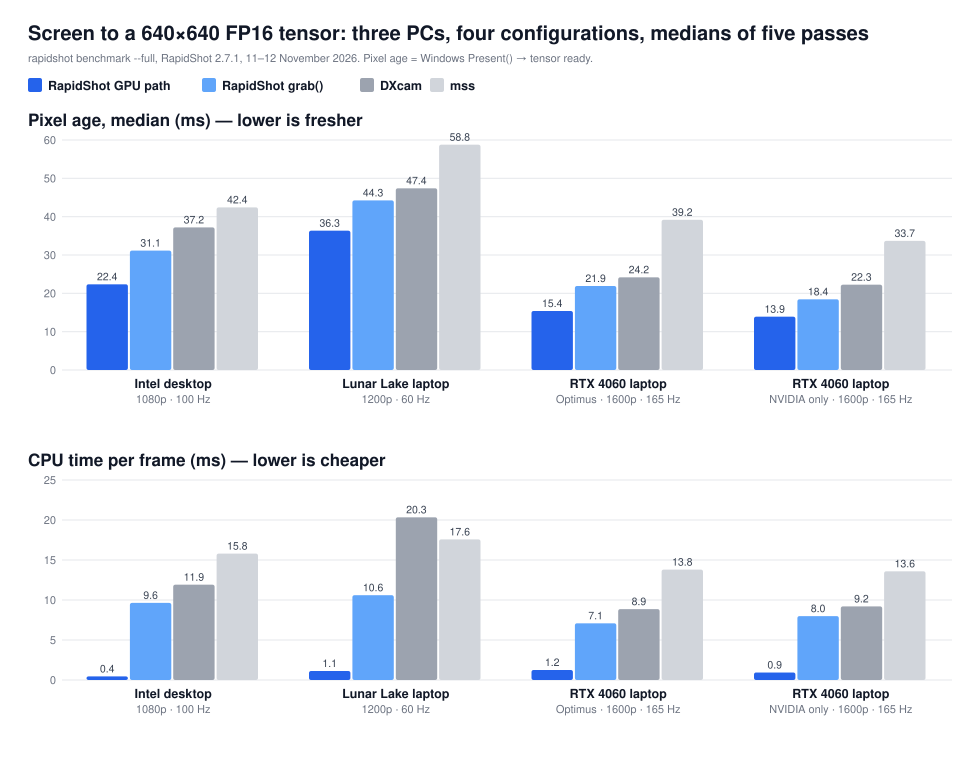

# RapidShot

[](https://github.com/Zaatra/Rapidshot/actions/workflows/ci.yml)
[](https://pypi.org/project/rapidshot/)
[](https://pypi.org/project/rapidshot/)
[](LICENSE)

**The Windows desktop, in Python, fresher and cheaper than anything else we
measured: a NumPy array when you want one, a model-ready GPU tensor when you
don't, without the pixels ever touching the CPU.**

```text
Windows desktop → native GPU frame → fused preprocessing → Torch / CuPy / DLPack
```

## Measured, not claimed

Same benchmark, same build, on three PCs and four graphics configurations. Each
library was timed by **pixel age**: how old the screen's pixels were, from
Windows' own `Present()` of the frame, by the time they were a
`(1, 3, 640, 640)` FP16 tensor ready for a model. Medians of five passes.

| PC | screen | RapidShot `GpuConverter` | DXcam | fresher by | CPU per frame, RapidShot vs DXcam |
| --- | --- | ---: | ---: | ---: | ---: |
| Intel desktop, Core Ultra 5 235 | 1080p, 100 Hz | **22.4 ms** at 100.0 fps | 37.2 ms at 86.5 fps | **14.8 ms** | **0.4** vs 11.9 ms |
| Lunar Lake laptop, Core Ultra 5 226V | 1200p, 60 Hz | **36.3 ms** at 59.5 fps | 47.4 ms at 51.2 fps | **11.0 ms** | **1.1** vs 20.3 ms |
| RTX 4060 laptop, Optimus | 1600p, 165 Hz | **15.4 ms** at 162.7 fps | 24.2 ms at 108.2 fps | **8.8 ms** | **1.2** vs 8.9 ms |
| RTX 4060 laptop, NVIDIA only | 1600p, 165 Hz | **13.9 ms** at 164.6 fps | 22.3 ms at 135.1 fps | **8.4 ms** | **0.9** vs 9.2 ms |

On every one of them RapidShot's GPU path delivered the **freshest pixels, at
the screen's full refresh rate, for 4-14% of DXcam's CPU**. And you do not need
the GPU path to come out ahead: plain `grab()` into NumPy also beat DXcam's
default backend on frames, pixel age and CPU on all four.



The full tables, memory included, are in [Performance](#performance), and
[`rapidshot benchmark`](#run-it-on-your-machine) runs the same harness on your
machine.

## Why RapidShot

- **Fresher frames.** A frame is converted where it was captured, in one GPU
  dispatch, and handed over without a readback. The figures above are that path.
- **Model-ready tensors in one line.** Crop, resize, colour order,
  normalisation, FP16 and layout in a single Direct3D 12 dispatch, then
  `to_torch()`, `to_cupy()` or `to_dlpack()`, zero-copy. No `ctypes`.
- **Hybrid laptops handled.** Optimus-style machines capture on the integrated
  GPU and run CUDA on the discrete one. RapidShot converts first and moves the
  2.46 MB tensor rather than a 16 MB frame, and was verified byte-exact on a
  real Intel UHD → RTX 4060 pair.
- **Any source.** Whole displays, regions or single windows, through DXGI
  Desktop Duplication or Windows.Graphics.Capture, with a planner that
  measures which backend is fresher on *your* machine instead of guessing.
- **Still a screenshot library.** `pip install rapidshot`, `camera.grab()`, a
  NumPy array. No GPU knowledge, no compiler, no native extension.
- **Correct before fast.** Every conversion is checked against an independent
  reference before it is timed. A fast wrong answer is worthless.

RapidShot began as a merge of [DXcam](https://github.com/ra1nty/DXcam) forks
and keeps a familiar API; the capture path, the colour pipeline and the GPU
interop have since been rewritten.

## Quick start

A screenshot, as a NumPy array. No GPU knowledge, no native extension:

```python
import rapidshot

camera = rapidshot.create()          # primary output, RGB
frame = camera.grab()                # (H, W, 3) uint8, or None if nothing changed
if frame is not None:
    print(frame.shape)
    frame.release()                  # return the pooled buffer
camera.release()
```

A model-ready FP16 tensor on the GPU, never touching the CPU. Needs
`rapidshot[native]`:

```python
import rapidshot

camera = rapidshot.create()
stream = rapidshot.TensorStream(camera, size=(640, 640),
                                dtype="float16", layout="NCHW")

for tensor in stream:
    prediction = model(tensor.to_torch())
```

Use `TensorStream` rather than writing that loop by hand. It closes the four
ways a hand-written loop goes quietly wrong: a held frame stalls capture, the
reused output buffer races the model, `None` means both "nothing changed" and
"capture has died", and a rebuilt capture can land on a new adapter.

> **On a hybrid laptop, `to_torch()` above raises `CrossAdapterRequired`.** That
> is not a bug. On an Optimus-style machine the display, and therefore capture,
> lives on the integrated GPU while CUDA only sees the discrete one, so there is
> nothing for CUDA to import until the tensor has crossed. Add one object:
> [Hybrid GPU laptops](#hybrid-gpu-laptops). `rapidshot.diagnose()` tells you
> which kind of machine you are on before you write any of this.

For explicit control, drive the converter yourself:

```python
camera = rapidshot.create()

with camera.grab_frame() as frame:            # GPU texture, no CPU copy
    converter = rapidshot.GpuConverter(       # build once, reuse every frame
        frame, (640, 640), dtype="float16", layout="NCHW",
    )
    tensor = converter.process(frame)
    x = tensor.to_torch()                     # zero-copy
    prediction = model(x)
```

`GpuConverter` takes the frame first: it needs the source surface to size its
resources. Build it once outside your loop and call `process()` per frame; the
output buffer is reused, which is why `TensorStream` synchronises before
overwriting it.

`to_cupy()` and `to_dlpack()` are the same tensor by other routes:

```python
array   = tensor.to_cupy()     # cupy.ndarray, zero-copy
capsule = tensor.to_dlpack()   # any framework implementing DLPack
```

All three alias the converter's buffer, so the next `process()` overwrites them.
Clone if you need one to outlive the next frame.

## Choose your path

| Goal | API | CPU pixels? | Native required? |
| --- | --- | --- | --- |
| NumPy screenshot | `camera.grab()` | Yes | No |
| One window | `create(source=Window.find(...))` | Either | **Yes** (WGC) |
| Which backend, measured | `rapidshot.plan(calibrate=True)` | -- | No |
| GPU frame, no readback | `camera.grab_frame()` | No | No |
| Model-ready FP16 tensor | `rapidshot.GpuConverter` | No | **Yes** |
| Capture-to-model loop | `rapidshot.TensorStream` | No | **Yes** |
| PyTorch | `tensor.to_torch()` | No | **Yes** |
| CuPy | `tensor.to_cupy()` | No | **Yes** |
| Any DLPack framework | `tensor.to_dlpack()` | No | **Yes** |
| Encoder input (NV12 / P010) | `GpuConverter(pixel_format=…)` | No | **Yes** |
| Hybrid GPU (Optimus) | `GpuConverter` + `TensorTransfer` | No | **Yes** |

## Installation

```bash
pip install rapidshot
```

That is the whole library for CPU and D3D11 capture: `grab()`, `grab_frame()`,
regions, colour conversion, dirty rects, video recording. **No toolchain, no
compiler, no GPU requirement.**

The GPU tensor, window capture and the hybrid-GPU transfer need the prebuilt
native extension:

```bash
pip install "rapidshot[native]"
```

This installs **`rapidshot-native >= 0.3.1`**: 0.2.0 is the minimum that exports
`GpuConverter` and `TensorTransfer`, 0.3.0 adds the Windows.Graphics.Capture
session behind `backend="wgc"` and window capture, and 0.3.1 makes NV12/P010
chroma left-sited, as H.264 and HEVC expect. With an older extension, RapidShot
names the version a feature needs instead of failing obscurely:

```text
RuntimeError: GpuConverter12 requires rapidshot-native >= 0.2.0; the installed
extension is version 0.1.0, from rapidshot-native wheel.

Upgrade the prebuilt wheel:
    pip install --upgrade 'rapidshot-native>=0.2.0'
```

Other extras: `rapidshot[gpu_cuda12]` or `[gpu_cuda13]` for CuPy (pick one;
the `cupy-cudaNNx` wheels are mutually exclusive), `rapidshot[benchmark]` for
the [benchmark command](#run-it-on-your-machine), and `rapidshot[all]` for
everything that is not CUDA-version-specific.

Check what your machine actually has:

```python
import rapidshot
print(rapidshot.diagnose())
```

It reports the adapters, outputs, which GPU drives each display, whether the
native extension loaded and from where, and which optional dependencies are
present, before you write any capture code.

## The pipeline

```text
                              ┌── NumPy / OpenCV        grab()
                              │
   DXGI / WGC ──→ GPU frame ──┼── raw GPU texture       grab_frame()
                              │
                              └── GpuConverter
                                       │
                          crop · resize · RGB/BGR
                          normalize · FP16 · layout
                              (one GPU dispatch)
                                       │
                          ┌────────────┼────────────┐
                          ↓            ↓            ↓
                       Torch         CuPy        DLPack
```

On a hybrid laptop the tensor crosses adapters *after* preprocessing, so what
moves is a small tensor rather than a full frame; see
[Hybrid GPU laptops](#hybrid-gpu-laptops).

## Capturing to NumPy

```python
camera = rapidshot.create(output_color="BGR")          # RGB, BGR, RGBA, BGRA, GRAY
frame  = camera.grab(region=(0, 0, 1920, 1080))        # left, top, right, bottom
```

`grab()` returns `None` when nothing has changed: Desktop Duplication reports
only *changed* content, so an idle desktop legitimately produces no frames.

Continuous capture runs on a background thread:

```python
camera.start(target_fps=60, video_mode=True)
for _ in range(120):
    frame = camera.get_latest_frame()
    ...
camera.stop()
```

One Desktop Duplication camera per output: DXGI allows one duplication per
display per process, so create several for several monitors.
`rapidshot.create()` returns the same camera for the same output if you ask
twice. WGC cameras have no such limit.

### Frame buffers and who owns them

`grab()` returns a `PooledBuffer`: a reused buffer, not a fresh array.
Allocating per frame costs about 1.6 ms on a 1080p RGB frame, because
first-touch page faults cost more than the conversion.

```python
frame = camera.grab()
if frame is not None:
    frame.shape, frame.dtype, frame.ndim
    pixel = frame[y, x]
    arr = np.asarray(frame)             # zero-copy, for cv2 / PIL / a model
    frame.release()                     # the one new line
```

**Release when you are done.** The buffer goes back to the pool and on to the
next capture. Reading it after release raises `BufferReleasedError` rather than
returning stale pixels. To keep the data, use `frame.copy()` or
`np.array(frame, copy=True)`.

Forgetting to release is never *corrupting*: the pool will not hand out a
buffer someone is still reading. With a conversion (`RGB`, `BGR`, `RGBA`,
`GRAY`) an exhausted pool falls back to allocating. `BGRA` converts nothing, so
the frame you hold *is* the staging buffer and there is nothing to fall back to:
`grab()` returns `None` until one comes back.

Prefer plain arrays? `rapidshot.create(pool_output=False)`.

## Sources and backends

A *source* is what to capture; a *backend* is how its pixels are delivered.

```python
import rapidshot
from rapidshot import Monitor, Region, Window

camera = rapidshot.create(source=Monitor())                    # the primary display
camera = rapidshot.create(source=Monitor(1), backend="wgc")    # a display, through WGC
camera = rapidshot.create(source=Region(0, 0, 1280, 720))      # virtual-desktop coordinates
camera = rapidshot.create(source=Window.find("Notepad"))       # one window: always WGC
```

| | Desktop Duplication (`"dxgi"`) | Windows.Graphics.Capture (`"wgc"`) |
| --- | --- | --- |
| Captures | a whole display | a display or a single window |
| Needs | nothing extra | `rapidshot-native >= 0.3.0` |
| Process on the display's adapter | required (RapidShot tries every adapter) | not required |
| Dirty / move rectangles, cursor shape | reported | `None` |
| Cameras per display | one | as many as you like |
| Frame time | DXGI's present time | arrival from the compositor (WGC's own timestamp is not a capture time) |

`backend="auto"` is the default. For a window it means WGC, the only backend
that can capture one. For a display named by `source` it follows the planner's
cached measurement, and without one it uses Desktop Duplication, falling back
to WGC with a warning only when every adapter refuses duplication. A call that
names no `source` keeps its 2.6 behaviour.

**Which backend is better here?** Ask, and measure:

```python
plan = rapidshot.plan(Monitor(), consumer="torch", size=(640, 640), calibrate=True)
print(plan)
```

`calibrate=True` covers the primary display with RapidShot's test source for a
few seconds and times each backend's `grab()` at the size the source captures:
pixel age from the source's `Present()` to your code, frames delivered, CPU per
frame. The freshest wins; within 1 ms, the one delivering more frames; within
3% of those too, the cheaper one. The plan says which criterion decided, which
adapter the consumer is on, whether frames cross adapters and where the
preprocessing belongs. Results are cached per machine
(`%LOCALAPPDATA%\rapidshot\plans.json`), keyed on adapters, drivers, display
mode, the adapter driving the display, the power source and versions, so an
upgrade, a MUX switch or unplugging the charger is measured afresh.
`python -m rapidshot plan --calibrate` does the same from a terminal.

A calibration times the CPU path, `grab()` into NumPy. A GPU consumer uses
`grab_frame()` and `GpuConverter` instead, which it does not time, and the plan
says so rather than presenting the CPU result as the answer for both.

**A window's lifetime is part of the capture.** Resized: the camera rebuilds at
the new size and `camera.generation` increments. Minimised: each `grab()`
waits its timeout and returns `None`, without spinning. Closed: capture stops,
and `camera.last_capture_error` says the window was closed.

`examples/window_to_numpy.py` and `examples/window_to_tensor.py` are both paths
end to end, a window into NumPy and a window into a 640x640 FP16 tensor without
a CPU copy, and show each of those transitions as it happens.

## GPU-resident frames

`grab_frame()` hands back the Direct3D texture itself. Nothing is copied to
system memory.

```python
with camera.grab_frame() as frame:      # the context manager is the safe form
    tex = frame.d3d11_texture           # ID3D11Texture2D, valid until release
    print(frame.width, frame.height, frame.timestamp_qpc)
```

**A held frame blocks capture.** DXGI will not produce the next frame while a
reference is outstanding, so release promptly; `with` does it for you.

Frames also carry the compositor's metadata: `dirty_rects` and `move_rects` in
frame coordinates, `changed_fraction`, `accumulated_frames`, `cursor`,
`rotation_angle`, `protected_content` and `timestamp_qpc`. With Desktop
Duplication that is the present itself; with WGC it is when the frame arrived
from the compositor, taken on WGC's own thread, so `frame.age_ms` includes the
time a frame waited for you.

## Model-ready tensors

`GpuConverter` is one compute dispatch that does all of it:

| Option | Values |
| --- | --- |
| `size` | output `(width, height)` |
| `dtype` | `"float32"`, `"float16"`, `"uint8"` |
| `layout` | `"nchw"` (default), `"nhwc"` |
| `sampling` | `"bilinear"` (default), `"nearest"` |
| `normalize` | `True` → 0..1, `False` → 0..255 |
| `bgr` | channel order |
| `crop` | `(left, top, right, bottom)`, frame coordinates, applied before resize |
| `batch` / `regions=` | multi-ROI, **one dispatch**, returns `(N, …)` |
| `pixel_format` | `"nv12"` / `"p010"` for encoder input |

Multi-ROI in a single dispatch:

```python
converter = rapidshot.GpuConverter(frame, (224, 224), batch=4)
tensor = converter.process(frame, regions=[
    (0, 0, 400, 300), (800, 40, 1000, 240),
])                                          # (2, 3, 224, 224)
```

Payload sizes at 640², which is what crosses a bus if anything has to:

| dtype | shape | bytes |
| --- | --- | --- |
| `uint8` (resized BGRA) | `(1, 640, 640, 4)` | 1.64 MB |
| `float16` | `(1, 3, 640, 640)` | **2.46 MB** |
| `float32` | `(1, 3, 640, 640)` | 4.92 MB |

against 8.29 MB for a 1080p frame or 16.38 MB at 2560×1600.

**Encoder input.** `pixel_format="nv12"` (8-bit) and `"p010"` (10-bit) write
BT.709 4:2:0 for a hardware video encoder, with left-sited chroma as H.264 and
HEVC expect, checked against a CPU reference and the published inverse
matrices.

## Hybrid GPU laptops

On an Optimus-style laptop the display is driven by the integrated GPU, so
capture happens there, while CUDA lives on the discrete GPU. Something has to
cross, and RapidShot moves the converted tensor rather than the frame:

```text
move the frame, convert on arrival
   2560×1600 BGRA (16.38 MB) → cross-adapter transfer → resize/RGB/normalize → model

convert first, move the result
   2560×1600 capture → crop/resize/RGB/normalize/FP16 → 2.46 MB tensor
                     → cross-adapter transfer → model
```

```python
converter = rapidshot.GpuConverter(frame, (640, 640), dtype="float16")
transfer  = rapidshot.TensorTransfer(converter)
converter.process(frame)
transfer.transfer()
```

This is also the answer to `CrossAdapterRequired` from the quick start: once the
tensor is on the CUDA adapter, the consumer imports it there.

**Verified on real hybrid hardware**, Intel UHD Graphics capture and an RTX 4060
destination at 2560×1600:

- Frames arrive byte-exact on the other GPU, by both the waiting and the
  asynchronous copy, and the CUDA consumer handshake prevents a stale read:
  the 32 live cross-adapter tests all passed there on 2026-11-12.
- The converted-tensor path was verified end to end with **CUDA importing the
  transferred buffer** from the shared D3D12 heap on the discrete GPU, max
  deviation **1 RGB8 level**, the documented bilinear rounding tolerance.
- Measured on that laptop: **162.7 fps, pixels 15.4 ms old, 1.2 ms of CPU per
  frame**, against DXcam's 108.2 fps, 24.2 ms and 8.9 ms. Moving the whole
  frame across instead manages 81.2 fps; convert first.

A WARP result is not evidence for this path. `TensorTransfer` once handed the
consumer the *source* device's handle, and against a WARP destination that
still "passed": CUDA imported the capture GPU's own memory and reported a
crossing that never happened. The checks above need two real GPUs.

**When a hybrid laptop refuses capture altogether.** On a muxless laptop where
Windows runs Python on the discrete GPU, DXGI lists the screen under that GPU
and refuses every duplication with `DXGI_ERROR_UNSUPPORTED`, whichever adapter
is tried (Microsoft KB3019314).
RapidShot compares the GPU each display is wired to with the GPU DXGI lists it
under; where they differ, the error, `describe()` and `diagnose()` name both
GPUs and the interpreter to set to **Power saving** in Settings > System >
Display > Graphics. Found on a ThinkPad E580 (Intel UHD 620 + Radeon 500).

## Performance

Every figure here was recorded on 11-12 November 2026 by `rapidshot benchmark
--full` with RapidShot 2.7.1 and a pre-release build of `rapidshot-native`
0.4.0, whose additions none of the measured paths use. Each machine's report
is in [`benchmarks/`](benchmarks/) as Markdown and as JSON with every pass.

**How it measures.** A test source draws a frame ID into the image and records
the time of every `Present()`. Each library then turns the desktop into the
same `(1, 3, 640, 640)` FP16 tensor, on CUDA where there is an NVIDIA GPU and
in system memory or on the capture GPU where there is not, and each frame's
pixel age is read off its ID against that one clock. Every path is verified to
produce the right tensor before it is timed. *Unique frames/s* counts frames
with a new ID, so a library cannot score by handing back the same picture
twice, and it cannot exceed the screen's refresh rate: a value marked \* reached
the test source's own rate in at least one pass, so it is a floor.

### Screen to tensor

**Intel desktop**: Core Ultra 5 235, Intel graphics only, 1920×1080 at 100 Hz
([report](benchmarks/rapidshot-benchmark-machineA-2026-11-11.md)). No CUDA, so
the tensor ends in system memory, or on the capture GPU through Direct3D 12 for
`GpuConverter`.

| | unique frames/s | pixel age p50 / p95 | CPU per frame |
| --- | ---: | ---: | ---: |
| mss | 33.3 | 42.4 / 45.4 ms | 15.8 ms |
| DXcam (DXGI) | 86.5 | 37.2 / 42.5 ms | 11.9 ms |
| DXcam (WGC) | 85.8 | 37.9 / 42.9 ms | 11.7 ms |
| RapidShot `grab()` | 100.0\* | 31.1 / 32.5 ms | 9.6 ms |
| RapidShot `grab()`, WGC | 99.0\* | 30.8 / 31.8 ms | 9.6 ms |
| RapidShot `grab()` of a window, WGC | 98.7 | 30.8 / 32.0 ms | 9.4 ms |
| **RapidShot `GpuConverter`** | **100.0** | **22.4 / 22.9 ms** | **0.4 ms** |

**Lunar Lake laptop**: HP OmniBook X Flip 16, Core Ultra 5 226V, Arc 130V,
1920×1200 at 60 Hz, on charger in Best performance
([report](benchmarks/rapidshot-benchmark-lunarlake-2026-11-11.md)). No CUDA.

| | unique frames/s | pixel age p50 / p95 | CPU per frame |
| --- | ---: | ---: | ---: |
| mss | 29.9 | 58.8 / 75.3 ms | 17.6 ms |
| DXcam (DXGI) | 51.2 | 47.4 / 57.4 ms | 20.3 ms |
| DXcam (WGC) | 59.8 | 46.6 / 55.6 ms | 13.5 ms |
| RapidShot `grab()` | 59.1 | 44.3 / 45.0 ms | 10.6 ms |
| RapidShot `grab()`, WGC | 53.4 | 44.6 / 48.9 ms | 11.4 ms |
| RapidShot `grab()` of a window, WGC | 53.0 | 44.5 / 48.0 ms | 10.4 ms |
| **RapidShot `GpuConverter`** | **59.5** | **36.3 / 37.1 ms** | **1.1 ms** |

On this 60 Hz panel DXcam's WGC backend also kept up with the screen; its
pixels were still 10.3 ms older than `GpuConverter`'s, at twelve times the CPU.

**RTX 4060 laptop, Optimus**: Acer Predator PHN16-72, i9-14900HX; the Intel UHD
drives the 2560×1600 165 Hz screen and CUDA runs on the RTX
([report](benchmarks/rapidshot-benchmark-machineB-optimus-2026-11-12.md)).

| | unique frames/s | pixel age p50 / p95 | CPU per frame |
| --- | ---: | ---: | ---: |
| mss | 33.1 | 39.2 / 41.8 ms | 13.8 ms |
| DXcam (DXGI) | 108.2 | 24.2 / 27.3 ms | 8.9 ms |
| DXcam (WGC) | 107.6 | 28.8 / 32.6 ms | 8.9 ms |
| RapidShot `grab()` | 132.7 | 21.9 / 23.2 ms | 7.1 ms |
| RapidShot `grab()`, WGC | 122.1 | 24.4 / 27.8 ms | 7.5 ms |
| RapidShot `grab()` of a window, WGC | 122.0 | 24.3 / 27.8 ms | 7.2 ms |
| RapidShot `grab()`, `nvidia_gpu=True` | 119.3 | 22.4 / 23.7 ms | 4.5 ms |
| RapidShot, full frame across adapters | 81.2 | 22.2 / 24.8 ms | 4.6 ms |
| **RapidShot `GpuConverter` + `TensorTransfer`** | **162.7**\* | **15.4 / 15.9 ms** | **1.2 ms** |

**RTX 4060 laptop, NVIDIA only**: the same laptop with its MUX giving the
screen to the RTX, so capture and CUDA share one GPU
([report](benchmarks/rapidshot-benchmark-machineB-nvidia-only-2026-11-12.md)).

| | unique frames/s | pixel age p50 / p95 | CPU per frame |
| --- | ---: | ---: | ---: |
| mss | 40.6 | 33.7 / 36.5 ms | 13.6 ms |
| DXcam (DXGI) | 135.1 | 22.3 / 25.9 ms | 9.2 ms |
| DXcam (WGC) | 135.3 | 22.7 / 26.0 ms | 9.2 ms |
| RapidShot `grab()` | 162.0\* | 18.4 / 21.0 ms | 8.0 ms |
| RapidShot `grab()`, WGC | 162.0 | 18.5 / 23.5 ms | 7.7 ms |
| RapidShot `grab()` of a window, WGC | 162.5 | 18.5 / 21.6 ms | 7.5 ms |
| RapidShot `grab()`, `nvidia_gpu=True` | 148.7 | 22.0 / 22.9 ms | 6.6 ms |
| RapidShot direct, single adapter | 87.1 | 19.1 / 20.1 ms | 6.2 ms |
| **RapidShot `GpuConverter`** | **164.6**\* | **13.9 / 14.4 ms** | **0.9 ms** |

The *direct, single adapter* row is held back by the benchmark rather than by
capture: to read the frame ID it converts each full 2560×1600 frame back to
BGRA in CuPy.

### Memory

Working set of the capturing process with the screen in motion, and in
brackets what capture added over the same process before its first frame:

| | Intel desktop | Lunar Lake laptop | RTX laptop, Optimus | RTX laptop, NVIDIA only |
| --- | ---: | ---: | ---: | ---: |
| mss | 71.5 MB (+20.5) | 66.3 MB (+18.5) | 83.7 MB (+32.8) | 84.1 MB (+32.8) |
| DXcam | 95.1 MB (+9.9) | 94.9 MB (+9.5) | 103.9 MB (+23.8) | 105.4 MB (+25.6) |
| RapidShot `grab()` | 119.9 MB (+29.1) | 123.3 MB (+31.1) | 175.2 MB (+70.5) | 155.3 MB (+70.5) |
| **RapidShot `grab_frame()`** | **92.5 MB (+1.7)** | **92.9 MB (+0.9)** | 105.9 MB (+1.1) | **86.2 MB (+1.6)** |

The GPU path holds about what DXcam does, and capture itself adds 1-2 MB to it.
`grab()` is the one place DXcam stays lighter: it keeps converted output buffers
DXcam has no equivalent of, 20-70 MB more depending on the screen. No library's
working set grew by more than 0.09 MB/s over a run.

### Through a detector

The same pixel-age clock carried on to *usable detections*: YOLO11n on the RTX
4060 through ONNX Runtime's CUDA provider, NMS included, on the RTX laptop.
Recorded on RapidShot 2.6 with the older test source (see
[What this does not show](#what-this-does-not-show)), so compare the rows within
a table, not the milliseconds with the tables above.

| Optimus | unique frames/s | detections ready p50 | CPU per frame |
| --- | ---: | ---: | ---: |
| DXcam (DXGI) | 45.0 | 49.2 ms | 20.9 ms |
| RapidShot `grab()` | 51.3 | 46.5 ms | 19.2 ms |
| **RapidShot `GpuConverter` + `TensorTransfer`** | **69.5** | **41.4 ms** | **12.9 ms** |

| NVIDIA only | unique frames/s | detections ready p50 | CPU per frame |
| --- | ---: | ---: | ---: |
| DXcam (DXGI) | 37.7 | 53.8 ms | 28.0 ms |
| RapidShot `grab()` | 41.3 | 51.6 ms | 26.2 ms |
| **RapidShot `GpuConverter`** | **50.5** | **46.9 ms** | **19.2 ms** |

1.55× and 1.34× DXcam's frames through the model, detections 7-8 ms sooner,
with a third less CPU; every path found the same scene (8.4-9.7 detections a
frame). Full tables:
[`section7-inference-machineB-hybrid-2.6.1.json`](benchmarks/section7-inference-machineB-hybrid-2.6.1.json),
[`section7-inference-machineB-dgpu-2.6.0.json`](benchmarks/section7-inference-machineB-dgpu-2.6.0.json).

### Run it on your machine

```bash
pip install "rapidshot[benchmark]"
rapidshot benchmark
```

The same harness as the tables above: every installed library and every
RapidShot path this hardware supports, verified first, then timed by pixel age.
About five minutes; a test pattern fills the screen. With an NVIDIA GPU, add
`cupy-cuda12x` or `cupy-cuda13x` so the tensor is finished on CUDA as above.
`--full` adds CPU per tensor and memory (about ten minutes), and `--check` shows
what would run without running it. It writes a Markdown report and a JSON file
with no hostname, username or device IDs in them; please
[open a benchmark issue](https://github.com/Zaatra/Rapidshot/issues/new?template=benchmark.md)
with both. An AMD result would be especially welcome.

### What this does not show

- **Three PCs, each at one resolution, one refresh rate and one driver.** The
  columns are different screens, so compare libraries within a machine; across
  machines, compare the gaps. No AMD GPU has captured in these tables.
- **Background load.** On the Intel desktop other programs used more than 15%
  of the CPU in 10 of 35 timed cases; the other machines had none.
- **The detector tables use the older test source**, which let up to three
  frames queue behind `Present()`, adding a 0-3 frame offset to every path at
  once. The ranking and the within-table comparisons hold; the absolute
  milliseconds do not. The tables above use the newer source, which queues one.
- **Older capture-only comparisons** (RapidShot 2.1-2.4, a call-rate loop
  rather than pixel age) are kept as history in
  [`docs/BENCHMARKS.md`](docs/BENCHMARKS.md), with their methodology.

## Correctness guarantees

These are the disciplines the code actually enforces:

- **An independent reference comes before any performance claim.** Conversion
  kernels are checked byte-for-byte against NumPy; the GPU converter against a
  D3D11 staging readback of the same texture (`tests/test_gpu_converter.py`);
  NV12/P010 against a CPU reference *and* the published inverse matrices, so
  the kernel and its reference cannot share a wrong constant.
- **Frame lifetime is enforced, not documented.** Reading a released frame or a
  released buffer raises rather than returning stale pixels. Generation
  tracking invalidates frames from a duplicator that has been rebuilt.
- **GPU reads are ordered on the GPU.** `AcquireNextFrame` returns when the
  copy is *submitted*, not complete. Every D3D12 path that reads the capture
  surface waits on a shared fence; without it, measured stale-frame rates ran
  from 7/150 to 65/150.
- **Producer and consumer both have a barrier.** `GpuTensor.sync()` blocks
  until CUDA work on the buffer is done, and `set_consumer_fence()` stops the
  producer overwriting a buffer a consumer is still reading.
- **WARP is not a GPU.** A software adapter proves an API works and nothing
  about what it costs, and every table and message that uses one says so.

## Tested hardware

Nothing in RapidShot branches on GPU vendor. This is what has actually been
run, which is a different claim:

**Verified**

| Configuration | Notes |
| --- | --- |
| Intel desktop iGPU (Core Ultra 5 235) | Full suite and five-pass benchmark, 2026-11-11 |
| Intel Lunar Lake laptop (Arc 130V) | Full suite, rotation at 0/90/180/270°, five-pass benchmark, 2026-11-11 |
| NVIDIA dGPU driving the display (MUX, RTX 4060) | Capture and CUDA on one GPU; full suite and benchmark, 2026-11-12 |
| Hybrid Intel UHD → RTX 4060 (Optimus) | Capture on Intel, CUDA on the RTX; full suite, 32 live cross-adapter tests, benchmark, 2026-11-12 |
| Cross-adapter **tensor** transfer + CUDA import | `TensorTransfer` on real Optimus, CUDA reading the transferred buffer |
| Hybrid, capture to YOLO11n detections | All six hybrid paths verified, then timed |
| Python 3.9 – 3.14 | CI matrix |

**Partly verified, or not at all**

| Configuration | Status |
| --- | --- |
| AMD Radeon hybrid (ThinkPad E580, Intel UHD 620 + Radeon 500) | Found the refused-capture case above. Capture there runs on the Intel GPU: no screen is wired to the Radeon |
| AMD GPU capturing | **Not run.** The BGRA swizzle rule is confirmed on Intel and NVIDIA and follows from the DXGI format, but it is the one rule a silent mismatch would corrupt rather than crash |
| HDR panel with full Windows HDR support | **One machine**: Lunar Lake (Arc 130V) on a Samsung TU7100 4K TV over HDMI 2.0, FP16 scRGB, 2026-11-12; see below. Not yet on NVIDIA or AMD, or on a 10-bit HDR surface |
| Headless / virtual display (IDD) | Diagnostics exist; capture on one has not been run |

## Known limitations

**HDR desktops: converted to SDR, not captured as HDR.** With Windows HDR on,
the desktop is duplicated as linear light (scRGB, 1.0 = 80 nits) in a 10-bit or
FP16 surface rather than 8-bit sRGB:

- **`grab()` and `start()` return sRGB**, converted the way OBS and RustDesk
  convert HDR display capture: divide by the display's SDR white level, clip,
  apply the sRGB curve. SDR content comes back as the bytes it was drawn with;
  anything brighter than SDR white clips to white. That is SDR normalisation,
  not tone mapping.
- **`grab_frame()` says what it holds**: `frame.hdr`, `frame.sdr_white_nits`,
  `frame.pixel_format` and `frame.color_space`, which is `"scrgb"` for linear
  light. **`GpuConverter` converts it to sRGB by default** (`tone_map="auto"`),
  inside the same dispatch: identical to `grab()` for everything up to SDR
  white, and above it the pixel is scaled by its brightest channel rather than
  clipped channel by channel, so a highlight keeps its hue. `tone_map="clip"`
  is exactly what `grab()` returns; `tone_map="none"` refuses an HDR frame
  rather than put linear light into a tensor shaped for sRGB; and
  `allow_linear=True` passes scRGB through for float output. NV12 converts an
  HDR frame only when given a tone map (rapidshot-native 0.4.0); P010 refuses
  linear light.
- **Checked on one HDR panel**: an Intel Core Ultra 5 226V (Arc 130V) driving
  a Samsung TU7100 4K TV, HDR on, SDR white 240 nits, the desktop duplicated
  as FP16 scRGB. On the desktop and over 45 s of HDR video with highlights to
  3,460 nits and up to 42% of a frame above SDR white, `clip` matched `grab()`
  on every pixel and `auto` matched the test suite's reference to within one
  code (at least 99.9999% exact). A bright blue that `clip` turns cyan stays
  blue under `auto`. Colours outside sRGB's gamut are clamped per channel by
  both, as `grab()` does; there is no gamut mapping. That run was Desktop
  Duplication at one SDR white level, through `grab_frame()`. Not yet run:
  Windows.Graphics.Capture, NV12's tone map, `start()` across an HDR toggle,
  other SDR white levels, NVIDIA or AMD, or a desktop that duplicates as
  10-bit `R10G10B10A2`.
- **Samsung TVs need "Input Signal Plus"** (Settings > General > External
  Device Manager) on the HDMI port in use. Without it the TV offers HDMI 1.4
  bandwidth -- 4K at 30 Hz, no HDR -- and Windows reports the display as not
  supporting HDR.
- **On platforms without full Windows HDR support the capture is clipped at
  80 nits** before RapidShot sees it, and a warning says so. On an Intel Core
  i5-10500 (Comet Lake, UHD 630) driving a 4K HDR TV, everything brighter than
  80 nits, including ordinary SDR white at the usual 200-240 nit setting, came
  back flat. [Microsoft lists Comet Lake](https://learn.microsoft.com/en-us/windows/win32/direct3darticles/high-dynamic-range#graphics-processor-gpu)
  as not providing full HDR functionality. Turn HDR off (Win+Alt+B) there for
  exact colours.

**Task Manager overstates GPU memory for programs that create many
converters.** Each `GpuConverter` opens the captured surface once, and Windows
charges the process the surface's full size for every such opening without
taking it back when the converter is closed: 15.6 MiB per converter at
2560x1600, in Task Manager's per-process GPU memory and the
`\GPU Process Memory(*)` counters. The memory itself is released: adapter-wide
GPU memory, available RAM and commit stay flat. A program that keeps one
converter per camera never sees it. To measure a process's GPU memory, use
`rapidshot.util.gpu_memory.process_gpu_memory_mb()`, which reads DXGI's
`IDXGIAdapter3::QueryVideoMemoryInfo`.

**Windows.Graphics.Capture has limits of its own.** Its frames carry no dirty
or move rectangles and no cursor shape, so those are `None` rather than
guessed, and the cursor is not drawn into the image (as with Desktop
Duplication). It costs one GPU copy per frame, 0.75 ms at 2560x1600 on an Intel
UHD, because reading WGC's own surface is only safe while the frame is held,
and holding it delivers older frames. A window is captured at its frame
bounds, title bar included. Settings this Windows build does not support, such
as `MinUpdateInterval` before Windows 11 24H2 (which leaves WGC at 55 fps on a
165 Hz display), are a logged warning naming what you get instead.

## Diagnostics and troubleshooting

```python
import rapidshot
print(rapidshot.diagnose())                 # adapters, outputs, extension, deps
print(rapidshot.diagnose(probe_gpu=True))   # also probe D3D12 sharing
```

From a shell, `rapidshot diagnose` prints the same report.

| Symptom | Cause |
| --- | --- |
| `grab()` returns `None` | Nothing changed on screen. This is normal, not an error. |
| `None` forever in `BGRA` | Pool exhausted: release your frames, or raise `pool_size_frames`. |
| `AttributeError` on `GpuConverter` | Native extension older than 0.2.0. Upgrade it. |
| `CrossAdapterRequired` | Capture is on the iGPU and CUDA is on the dGPU: the hybrid case. |
| `DXGI_ERROR_UNSUPPORTED` on every adapter of a laptop | Python is running on the discrete GPU of a muxless laptop; the error names the setting. See [Hybrid GPU laptops](#hybrid-gpu-laptops). |
| `RapidShotProtectedContentError` | HDCP/DRM content; the OS blanks the region. |
| Capture stops after a resolution change | Handled automatically; see `on_output_change`. |
| Nothing captures at all | No desktop session (a CI runner, a service, an RDP session with no console). |

## Advanced: native interop

For consumers that bind GPU resources directly, such as DirectML, ONNX Runtime
or a custom CUDA kernel, the underlying handles are reachable:

- `converter.output_resource_address`: the `ID3D12Resource` address, the
  vendor-neutral route for DirectML and ONNX Runtime. It is on the converter,
  not the tensor, and covers the whole buffer including every batch slot;
  `converter.output_byte_size` is its size.
- `native.CrossAdapterTransfer`: move a whole *frame* across adapters, with
  `transfer_async()`, `shared_fence_handle`, `set_consumer_fence()` and
  `wait_for_consumer()`.
- `native.probe_d3d12_sharing()`, `probe_shareable_buffers()`,
  `texture_sharing_info()`: capability probes.
- `GpuPreprocessor12`: the 2.3-era NCHW float32 preprocessor, unchanged.

`examples/gpu_tensor_to_cupy.py` and `examples/verify_cross_adapter.py` are the
worked, commented versions. You should not need any of this to use
`GpuConverter`.

## What's new

- **2.7.4** (with rapidshot-native 0.4.1): switching Windows HDR on or off no
  longer leaves `grab_frame()` returning `None` for good on NVIDIA; the frame
  captured during a switch keeps its own colour space.
- **2.7.3** (with rapidshot-native 0.4.0): `GpuConverter` converts HDR frames
  to sRGB by default, checked on an HDR panel; NV12 for an encoder from an HDR
  desktop; a WGC camera left open at exit no longer crashes the process.
- **2.7.2**: a hybrid laptop that refuses capture on every GPU now names the
  GPU setting that fixes it; Desktop Duplication keeps its 10-bit and HDR
  formats whatever DPI awareness the host process set; the measurements above.
- **2.7**: window capture and Windows.Graphics.Capture, `Monitor` / `Window` /
  `Region` sources, a measuring planner (`rapidshot.plan`), and an HDR tone map
  in `GpuConverter`. 2.7.1 makes NV12/P010 chroma left-sited.
- **2.6**: fused GPU preprocessing with native FP16, one-call `to_torch()` /
  `to_cupy()` / `to_dlpack()`, convert-before-transfer on hybrid GPUs, 58% less
  memory than 2.5 for `grab()`, and `rapidshot benchmark`.

Every change, with the measurement behind it, is in
[`CHANGELOG.md`](CHANGELOG.md).

**Upgrading from 2.5:** `rapidshot-native >= 0.2.0` is required for the GPU
tensor features (`pip install --upgrade "rapidshot[native]"`); `GpuConverter`
replaces `GpuPreprocessor12` as the recommended transform, and
`sampling="nearest"` reproduces the old one bit for bit; `to_torch()` /
`to_cupy()` / `to_dlpack()` replace the `ctypes` recipe; and
`pool_size_frames` now defaults to 2 (pass `4` for the old behaviour). Nothing
was renamed or removed.

## Contributing

See [CONTRIBUTING.md](CONTRIBUTING.md). The one rule worth stating here:
**a correctness check against an independent reference comes before any
performance claim.** A fast wrong answer is worthless.

Plans and their reasoning are in [ROADMAP.md](ROADMAP.md); older measurements
and their methodology in [`docs/BENCHMARKS.md`](docs/BENCHMARKS.md).

## License

MIT; see [LICENSE](LICENSE).

## Acknowledgments

[DXcam](https://github.com/ra1nty/DXcam) and
[BetterCam](https://github.com/RootKit-Org/BetterCam), whose forks RapidShot
began as a merge of. DXcam is also the yardstick every table above is measured
against.
