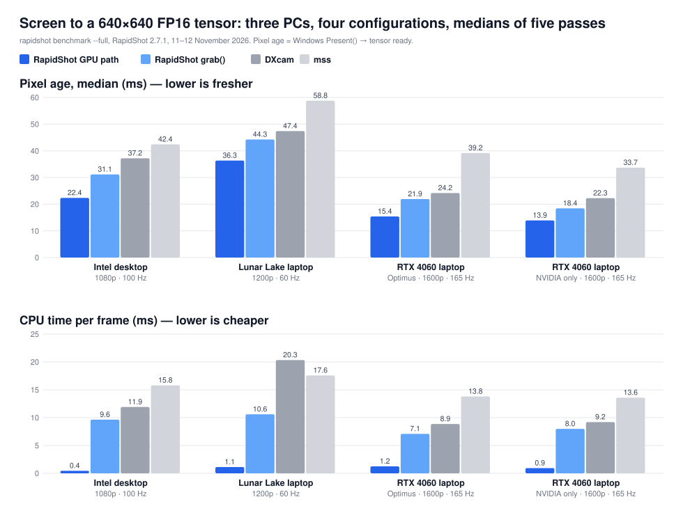

# RapidShot

[](https://github.com/Zaatra/Rapidshot/actions/workflows/ci.yml)
[](https://pypi.org/project/rapidshot/)
[](https://pypi.org/project/rapidshot/)
[](LICENSE)

**The Windows desktop, in Python, fresher and cheaper than anything else we
measured: a NumPy array when you want one, a model-ready GPU tensor when you
don't, and — new in 2.9 — only the tiles that actually changed, verified byte
for byte.**

```text
Windows desktop ─┬─ native GPU frame → fused preprocessing → Torch / CuPy / DLPack
                 └─ exact changed tiles → the 1.5 MiB that moved, not the 7.9 MiB frame
```

## Measured, not claimed

Same benchmark, same build, on three PCs and four graphics configurations. Each
library was timed by **pixel age**: how old the screen's pixels were, from
Windows' own `Present()` of the frame, by the time they were a
`(1, 3, 640, 640)` FP16 tensor ready for a model. Medians of five passes.

| PC | screen | RapidShot `GpuConverter` | DXcam | fresher by | CPU per frame, RapidShot vs DXcam |
| --- | --- | ---: | ---: | ---: | ---: |
| Intel desktop, Core Ultra 5 235 | 1080p, 100 Hz | **22.4 ms** at 100.0 fps | 37.2 ms at 86.5 fps | **14.8 ms** | **0.4** vs 11.9 ms |
| Lunar Lake laptop, Core Ultra 5 226V | 1200p, 60 Hz | **36.3 ms** at 59.5 fps | 47.4 ms at 51.2 fps | **11.0 ms** | **1.1** vs 20.3 ms |
| RTX 4060 laptop, Optimus | 1600p, 165 Hz | **15.4 ms** at 162.7 fps | 24.2 ms at 108.2 fps | **8.8 ms** | **1.2** vs 8.9 ms |
| RTX 4060 laptop, NVIDIA only | 1600p, 165 Hz | **13.9 ms** at 164.6 fps | 22.3 ms at 135.1 fps | **8.4 ms** | **0.9** vs 9.2 ms |

On every one of them RapidShot's GPU path delivered the **freshest pixels, at
the screen's full refresh rate, for 4-14% of DXcam's CPU**. And you do not need
the GPU path to come out ahead: plain `grab()` into NumPy also beat DXcam's
default backend on frames, pixel age and CPU on all four.



The full tables, memory included, are in [Performance](#performance), and
[`rapidshot benchmark`](#run-it-on-your-machine) runs the same harness on your
machine. **No AMD GPU has run it yet.** If you have one, or an HDR display, or
any setup unlike the four above, [your numbers are the most useful thing you
can send](#help-wanted-amd-gpus-hdr-displays-and-unusual-setups).

### And in 2.9: only the pixels that changed

A second claim, on its own fixture. `grab_tiles()` stages only the tiles
Desktop Duplication reports dirty, then checks **every byte of them** against a
private history — so what comes back is exactly what changed, not what the
compositor hinted at. A scripted desktop presents 1,530 known states at
30 updates/s; a consumer must find a marker in each and finish inside the
33.33 ms frame budget. **Both libraries run the same OpenCV search**, and DXcam
is handed change bounds from an independent full-frame byte scan, so this
compares libraries rather than algorithms:

| Same search, both sides | correct and on time | result pixel age p50/p95 | CPU, % of one core | GPU readback per result |
| --- | ---: | ---: | ---: | ---: |
| **RapidShot `grab_tiles()`** | **1,517/1,530** | **5.09 / 9.07 ms** | **14.09%** | **1.51 MiB** |
| DXcam 0.3.0 `grab_view()` + full byte scan | 1,514/1,530 | 7.30 / 10.28 ms | 24.81% | 7.91 MiB |

Three updates apart on the deadline, so the deadline is not the story — the
**cost** is. Identical answers, zero wrong detections on either side, for
**43% less CPU**, **2.2 ms fresher pixels** and **5.2× fewer bytes off the GPU**
per result. Against DXcam's *best* waiting strategy the CPU gap narrows but
does not close: still a third less. And against the pipeline most projects
actually write — a stock full-frame search — the same fixture finishes **0 of
1,530** inside the deadline, because that search alone takes 68.89 ms.

The tables, the crossover where this stops paying, the ~8 MiB it costs and the
one-hour soak behind it are in [Only what changed](#only-what-changed).
**Intel graphics, 1080p, 100 Hz** — this feature has not run on NVIDIA or AMD.

## Why RapidShot

- **Fresher frames.** A frame is converted where it was captured, in one GPU
  dispatch, and handed over without a readback. The figures above are that path.
- **Only what changed, and it is exact.** `grab_tiles()` copies just the dirty
  tiles off the GPU and then verifies them byte for byte against a private
  history, alpha included, so the change map is the truth rather than the
  compositor's hint — with a scheduled full-frame audit to prove it. Of the
  libraries we checked, none exposes a *verified* change map: DXcam 0.3.0
  exposes no change metadata at all, and `windows-capture` 2.0.1 has dirty
  regions in its Rust API but not in its Python frame wrapper. Either way, a
  hint is not a check.
- **Model-ready tensors in one line.** Crop, resize, colour order,
  normalisation, FP16 and layout in a single Direct3D 12 dispatch, then
  `to_torch()`, `to_cupy()` or `to_dlpack()`, zero-copy. No `ctypes`.
- **Hybrid laptops handled.** Optimus-style machines capture on the integrated
  GPU and run CUDA on the discrete one. RapidShot converts first and moves the
  2.46 MB tensor rather than a 16 MB frame, and was verified byte-exact on a
  real Intel UHD → RTX 4060 pair.
- **Any source.** Whole displays, regions or single windows, through DXGI
  Desktop Duplication or Windows.Graphics.Capture, with a planner that
  measures which backend is fresher on *your* machine instead of guessing.
- **Still a screenshot library.** `pip install rapidshot`, `camera.grab()`, a
  NumPy array. No GPU knowledge, no compiler, no native extension.
- **Correct before fast.** Every conversion is checked against an independent
  reference before it is timed. A fast wrong answer is worthless.

RapidShot began as a merge of [DXcam](https://github.com/ra1nty/DXcam) forks
and keeps a familiar API; the capture path, the colour pipeline and the GPU
interop have since been rewritten.

## Quick start

A screenshot, as a NumPy array. No GPU knowledge, no native extension:

```python
import rapidshot

camera = rapidshot.create()          # primary output, RGB
frame = camera.grab()                # (H, W, 3) uint8, or None if nothing changed
if frame is not None:
    print(frame.shape)
    frame.release()                  # return the pooled buffer
camera.release()
```

A model-ready FP16 tensor on the GPU, never touching the CPU. Needs
`rapidshot[native]`:

```python
import rapidshot

camera = rapidshot.create()
stream = rapidshot.TensorStream(camera, size=(640, 640),
                                dtype="float16", layout="NCHW")

for tensor in stream:
    prediction = model(tensor.to_torch())
```

Use `TensorStream` rather than writing that loop by hand. It closes the four
ways a hand-written loop goes quietly wrong: a held frame stalls capture, the
reused output buffer races the model, `None` means both "nothing changed" and
"capture has died", and a rebuilt capture can land on a new adapter.

> **On a hybrid laptop, `to_torch()` above raises `CrossAdapterRequired`.** That
> is not a bug. On an Optimus-style machine the display, and therefore capture,
> lives on the integrated GPU while CUDA only sees the discrete one, so there is
> nothing for CUDA to import until the tensor has crossed. Add one object:
> [Hybrid GPU laptops](#hybrid-gpu-laptops). `rapidshot.diagnose()` tells you
> which kind of machine you are on before you write any of this.

For explicit control, drive the converter yourself:

```python
camera = rapidshot.create()

with camera.grab_frame() as frame:            # GPU texture, no CPU copy
    converter = rapidshot.GpuConverter(       # build once, reuse every frame
        frame, (640, 640), dtype="float16", layout="NCHW",
    )
    tensor = converter.process(frame)
    x = tensor.to_torch()                     # zero-copy
    prediction = model(x)
```

`GpuConverter` takes the frame first: it needs the source surface to size its
resources. Build it once outside your loop and call `process()` per frame; the
output buffer is reused, which is why `TensorStream` synchronises before
overwriting it.

`to_cupy()` and `to_dlpack()` are the same tensor by other routes:

```python
array   = tensor.to_cupy()     # cupy.ndarray, zero-copy
capsule = tensor.to_dlpack()   # any framework implementing DLPack
```

All three alias the converter's buffer, so the next `process()` overwrites them.
Clone if you need one to outlive the next frame.

## Choose your path

| Goal | API | CPU pixels? | Native required? |
| --- | --- | --- | --- |
| NumPy screenshot | `camera.grab()` | Yes | No |
| Which tiles changed, exactly | `camera.grab_with_changes()` | Yes | No |
| Only the changed tiles' pixels | `camera.grab_tiles()` | Yes | No |
| One window | `create(source=Window.find(...))` | Either | **Yes** (WGC) |
| Which backend, measured | `rapidshot.plan(calibrate=True)` | -- | No |
| GPU frame, no readback | `camera.grab_frame()` | No | No |
| Model-ready FP16 tensor | `rapidshot.GpuConverter` | No | **Yes** |
| Capture-to-model loop | `rapidshot.TensorStream` | No | **Yes** |
| PyTorch | `tensor.to_torch()` | No | **Yes** |
| CuPy | `tensor.to_cupy()` | No | **Yes** |
| Any DLPack framework | `tensor.to_dlpack()` | No | **Yes** |
| Encoder input (NV12 / P010) | `GpuConverter(pixel_format=…)`, `output="texture"` for NV12 | No | **Yes** |
| Hybrid GPU (Optimus) | `GpuConverter` + `TensorTransfer` | No | **Yes** |

## Installation

```bash
pip install rapidshot
```

That is the whole library for CPU and D3D11 capture: `grab()`, `grab_frame()`,
regions, colour conversion, dirty rects, video recording. **No toolchain, no
compiler, no GPU requirement.**

The GPU tensor, window capture and the hybrid-GPU transfer need the prebuilt
native extension:

```bash
pip install "rapidshot[native]"
```

This installs **`rapidshot-native >= 0.5.0`**: 0.2.0 is the minimum that exports
`GpuConverter` and `TensorTransfer`, 0.3.0 adds the Windows.Graphics.Capture
session behind `backend="wgc"` and window capture, 0.3.1 makes NV12/P010
chroma left-sited, as H.264 and HEVC expect, 0.4.0 tone-maps HDR into NV12,
and 0.5.0 adds NV12 written straight into a texture for a hardware encoder and
stops `GpuConverter` blocking other Python threads while the GPU works. With
an older extension, RapidShot names the version a feature needs instead of
failing obscurely:

```text
RuntimeError: GpuConverter12 requires rapidshot-native >= 0.2.0; the installed
extension is version 0.1.0, from rapidshot-native wheel.

Upgrade the prebuilt wheel:
    pip install --upgrade 'rapidshot-native>=0.2.0'
```

Other extras: `rapidshot[gpu_cuda12]` or `[gpu_cuda13]` for CuPy (pick one;
the `cupy-cudaNNx` wheels are mutually exclusive), `rapidshot[benchmark]` for
the [benchmark command](#run-it-on-your-machine), and `rapidshot[all]` for
everything that is not CUDA-version-specific.

Check what your machine actually has:

```python
import rapidshot
print(rapidshot.diagnose())
```

It reports the adapters, outputs, which GPU drives each display, whether the
native extension loaded and from where, and which optional dependencies are
present, before you write any capture code.

## The pipeline

```text
                              ┌── NumPy / OpenCV        grab()
                              │
   DXGI / WGC ──→ GPU frame ──┼── raw GPU texture       grab_frame()
                              │
                              └── GpuConverter
                                       │
                          crop · resize · RGB/BGR
                          normalize · FP16 · layout
                              (one GPU dispatch)
                                       │
                          ┌────────────┼────────────┐
                          ↓            ↓            ↓
                       Torch         CuPy        DLPack
```

On a hybrid laptop the tensor crosses adapters *after* preprocessing, so what
moves is a small tensor rather than a full frame; see
[Hybrid GPU laptops](#hybrid-gpu-laptops).

## Capturing to NumPy

```python
camera = rapidshot.create(output_color="BGR")          # RGB, BGR, RGBA, BGRA, GRAY
frame  = camera.grab(region=(0, 0, 1920, 1080))        # left, top, right, bottom
```

`grab()` returns `None` when nothing has changed: Desktop Duplication reports
only *changed* content, so an idle desktop legitimately produces no frames.

Continuous capture runs on a background thread:

```python
camera.start(target_fps=60, video_mode=True)
for _ in range(120):
    frame = camera.get_latest_frame()
    ...
camera.stop()
```

`target_fps` describes the capture side. What a model or an agent cares about
is how old its frame is, so say that instead:

```python
camera.start(target_fps=240, policy="latest", max_age_ms=12)
frame = camera.get_latest_frame()   # the newest frame, never older than 12 ms
print(camera.stream_stats)          # what was replaced, dropped or too old
```

| `policy=` | Frames waiting for the consumer | Read with |
| --- | --- | --- |
| `"latest"` (default) | One, replaced by each new frame, so nothing stale queues up | `get_latest_frame()` |
| `"drop_oldest"` (default with `video_mode=True`) | Up to `max_buffer_len`; when full, the oldest is dropped | `get_latest_frame()`, or `get_next_frame()` in order |
| `"block"` | Up to `max_buffer_len`, none dropped: capture waits for the consumer | `get_next_frame()`, in order |

`max_age_ms` makes the readers skip any frame capture has not seen on screen
within that time, and wait for a fresh one. A still screen's frame stays
usable, since every poll that finds nothing new confirms it; what expires is a
frame left behind while capture was stalled or held back. `stream_stats`
keeps the reasons apart: `stale_frames_replaced`, `consumer_drops`,
`frames_expired`, and `capture_drops` (screen updates Windows merged into a
later frame), plus the age of the frames handed out.

**`policy="latest"` is the default since 2.8**, because it is what anything
live wants. It stops a slow consumer from paying for frames it will never
use, and a paused one from waking up to a backlog. `video_mode=True` keeps
`drop_oldest`, which repeating frames to hold a rate needs. Measured live with
[`benchmarks/freshness_policies.py --live`](https://github.com/Zaatra/Rapidshot/blob/main/benchmarks/freshness_policies.py):
a real camera on a 2560x1600, 165 Hz display under the frame-ID test source,
RGB output, pixel age from each frame's own `Present()`. Medians of 5 runs per
case in shuffled order, the RTX 4060 laptop
([DXGI](https://github.com/Zaatra/Rapidshot/blob/main/benchmarks/freshness-policies-live-dxgi.md),
[WGC](https://github.com/Zaatra/Rapidshot/blob/main/benchmarks/freshness-policies-live-wgc.md)):

| Consumer | `drop_oldest` (the default before 2.8) | `latest` (the default now) |
| --- | --- | --- |
| Model at 60 fps, Desktop Duplication | +764 MB, 5.50 ms capture CPU a frame, 112 frames captured a second, age p50 28.4 ms | +1 MB, **4.55 ms**, **132 fps**, **26.0 ms** |
| Model at 60 fps, WGC | +765 MB, 4.75 ms, 117 fps, 29.7 ms | +0 MB, **3.62 ms**, **144 fps**, **26.3 ms** |
| Agent that pauses 250 ms every second, Desktop Duplication | age p95 **352 ms**, max 502 ms, 117 frames older than the one before | age p95 23.9 ms, max 29.5 ms, none out of order |

The old default, `drop_oldest`, holds up to `max_buffer_len` (64) converted
frames behind a slow consumer, and once its two pooled buffers are out every
new frame is a fresh allocation: 1.9 million page faults in 6 s against 171. `latest` holds
one and recycles it, and the capture time it frees goes into capturing more
of the screen's frames, which is why its pixels are also 2-3 ms fresher here.
`block` only moves where frames are lost: behind a 30 fps writer it captured
40 frames a second where `drop_oldest` captured 111 and dropped the surplus,
and the frames it handed over were older (p50 2.2 s against 0.6 s). A
simulated-screen run of the same harness, which isolates the queue from
capture cost, gives the same picture
([1080p](https://github.com/Zaatra/Rapidshot/blob/main/benchmarks/freshness-policies-1080p.md),
[1600p](https://github.com/Zaatra/Rapidshot/blob/main/benchmarks/freshness-policies-1600p.md)).

One Desktop Duplication camera per output: DXGI allows one duplication per
display per process, so create several for several monitors.
`rapidshot.create()` returns the same camera for the same output if you ask
twice. WGC cameras have no such limit.

### Frame buffers and who owns them

`grab()` returns a `PooledBuffer`: a reused buffer, not a fresh array.
Allocating per frame costs about 1.6 ms on a 1080p RGB frame, because
first-touch page faults cost more than the conversion.

```python
frame = camera.grab()
if frame is not None:
    frame.shape, frame.dtype, frame.ndim
    pixel = frame[y, x]
    arr = np.asarray(frame)             # zero-copy, for cv2 / PIL / a model
    frame.release()                     # the one new line
```

**Release when you are done.** The buffer goes back to the pool and on to the
next capture. Reading it after release raises `BufferReleasedError` rather than
returning stale pixels. To keep the data, use `frame.copy()` or
`np.array(frame, copy=True)`.

Forgetting to release is never *corrupting*: the pool will not hand out a
buffer someone is still reading. With a conversion (`RGB`, `BGR`, `RGBA`,
`GRAY`) an exhausted pool falls back to allocating. `BGRA` converts nothing, so
the frame you hold *is* the staging buffer and there is nothing to fall back to:
`grab()` returns `None` until one comes back.

Prefer plain arrays? `rapidshot.create(pool_output=False)`.

### Exact changed tiles

Opt-in, new in 2.9, and the one thing here that no other Windows capture
library we checked offers at all. Two methods, both DXGI CPU BGRA8 SDR, both
keeping a **private byte-for-byte history** so the change map is verified
rather than trusted:

```python
import rapidshot

camera = rapidshot.create(output_color="BGRA", nvidia_gpu=False)
try:
    frame = camera.grab_tiles(tight_rectangles=True, audit_every=120)
    if frame is not None:
        with frame:                                  # a lease: released on exit
            for rect in frame.changes.tight_rectangles:
                patch = frame.materialize(rect)      # owned array, just this box
                search(patch)
finally:
    camera.release()
```

- **`grab_with_changes()`** hands back the whole frame plus the change map. Use
  it when the consumer wants a full image anyway.
- **`grab_tiles()`** stages only the candidate tiles off the GPU — 1.51 MiB
  instead of 7.91 on a sparse 1080p frame — and exposes them as read-only views
  through `frame.tiles`, or as an owned crop through `materialize(rect)`.

**Why the hint is not the answer.** Desktop Duplication's dirty rectangles say
which tiles *may* have changed. RapidShot compares those candidate tiles
against its history byte for byte, **all four BGRA bytes including alpha**, and
reports only the tiles that genuinely differ. Where the metadata cannot be
trusted — a frame gap, a move rectangle, rotation, accumulated frames, missing
or invalid rectangles — it falls back to a full exact comparison and names the
case in `changes.fallback_reason`.

| What you get | What it means |
| --- | --- |
| `None` | No image was delivered; the same reporting as `grab()` |
| `reason="initial"` / `"reset"` | First frame, or the source, geometry or region changed: every tile marked |
| `reason="changed"` | These tiles differ, byte for byte |
| `reason="identical"` | A frame arrived and **nothing** changed: an empty tile set, not `None` |

`changes` also carries `indices` (row-major 128×128 tile IDs), `rectangles`
(clipped tile bounds), `tight_rectangles` (the bounding box of the actual byte
changes inside each tile, when `tight_rectangles=True`), `size`,
`present_time_qpc` (DXGI's own `LastPresentTime`) and `accumulated_frames`.
The change map stays readable after the frame is released.

**Trust, measured rather than asserted.** `audit_every=N` runs a full pixel
comparison on every Nth hint-guided capture, corrects the map if the hints ever
under-reported, and disables hint-guided copies for that capture generation;
`camera.change_audit_stats()` reports the running totals. In a one-hour soak
through the public API this found **zero missed tiles in 187 full audits**,
beside 29,985 change maps each checked against an independent full scan.

**Leases, not copies.** `frame.pixels`, the tile views and a tiled snapshot are
leased until `release()`. Use the frame as a context manager or call `release()`
yourself; reading afterwards raises `BufferReleasedError`, and running out of
tiled snapshot slots raises `PoolExhaustedError` — both importable from
`rapidshot`. `pixels.copy()` and `materialize(rect)` give you an array that
outlives the lease. Editing a live lease is allowed: the history is updated
*before* the lease is exposed, so your edits cannot corrupt the next comparison.

**The search is yours.** RapidShot gives you the rectangles; it does not ship a
search planner or an OpenCV wrapper, because the right strategy depends on the
task. That also means the downstream saving only arrives if your consumer
really does restrict its work to those rectangles. What it saves, where it
stops paying, and what it costs to run are in
[Only what changed](#only-what-changed); the full contract, every fallback
reason and the concurrency rules are in
[`docs/EXACT_TILES.md`](https://github.com/Zaatra/Rapidshot/blob/main/docs/EXACT_TILES.md).

## Sources and backends

A *source* is what to capture; a *backend* is how its pixels are delivered.

```python
import rapidshot
from rapidshot import Monitor, Region, Window

camera = rapidshot.create(source=Monitor())                    # the primary display
camera = rapidshot.create(source=Monitor(1), backend="wgc")    # a display, through WGC
camera = rapidshot.create(source=Region(0, 0, 1280, 720))      # virtual-desktop coordinates
camera = rapidshot.create(source=Window.find("Notepad"))       # one window: always WGC
```

| | Desktop Duplication (`"dxgi"`) | Windows.Graphics.Capture (`"wgc"`) |
| --- | --- | --- |
| Captures | a whole display | a display or a single window |
| Needs | nothing extra | `rapidshot-native >= 0.3.0` |
| Process on the display's adapter | required (RapidShot tries every adapter) | not required |
| Dirty / move rectangles, cursor shape | reported | `None` |
| Cameras per display | one | as many as you like |
| Frame time | DXGI's present time | arrival from the compositor (WGC's own timestamp is not a capture time) |

`backend="auto"` is the default. For a window it means WGC, the only backend
that can capture one. For a display named by `source` it follows the planner's
cached measurement, and without one it uses Desktop Duplication, falling back
to WGC with a warning only when every adapter refuses duplication. A call that
names no `source` keeps its 2.6 behaviour.

**Which backend is better here?** Ask, and measure:

```python
plan = rapidshot.plan(Monitor(), consumer="torch", size=(640, 640), calibrate=True)
print(plan)
```

`calibrate=True` covers the primary display with RapidShot's test source for a
few seconds and times each backend's `grab()` at the size the source captures:
pixel age from the source's `Present()` to your code, frames delivered, CPU per
frame. The freshest wins; within 1 ms, the one delivering more frames; within
3% of those too, the cheaper one. The plan says which criterion decided, which
adapter the consumer is on, whether frames cross adapters and where the
preprocessing belongs. Results are cached per machine
(`%LOCALAPPDATA%\rapidshot\plans.json`), keyed on adapters, drivers, display
mode, the adapter driving the display, the power source and versions, so an
upgrade, a MUX switch or unplugging the charger is measured afresh.
`python -m rapidshot plan --calibrate` does the same from a terminal.

A calibration times the CPU path, `grab()` into NumPy. A GPU consumer uses
`grab_frame()` and `GpuConverter` instead, which it does not time, and the plan
says so rather than presenting the CPU result as the answer for both.

**A window's lifetime is part of the capture.** Resized: the camera rebuilds at
the new size and `camera.generation` increments. Minimised: each `grab()`
waits its timeout and returns `None`, without spinning. Closed: capture stops,
and `camera.last_capture_error` says the window was closed.

`examples/window_to_numpy.py` and `examples/window_to_tensor.py` are both paths
end to end, a window into NumPy and a window into a 640x640 FP16 tensor without
a CPU copy, and show each of those transitions as it happens.

## GPU-resident frames

`grab_frame()` hands back the Direct3D texture itself. Nothing is copied to
system memory.

```python
with camera.grab_frame() as frame:      # the context manager is the safe form
    tex = frame.d3d11_texture           # ID3D11Texture2D, valid until release
    print(frame.width, frame.height, frame.timestamp_qpc)
```

**A held frame blocks capture.** DXGI will not produce the next frame while a
reference is outstanding, so release promptly; `with` does it for you.

Frames also carry the compositor's metadata: `dirty_rects` and `move_rects` in
frame coordinates, `changed_fraction`, `accumulated_frames`, `cursor`,
`rotation_angle`, `protected_content` and `timestamp_qpc`. With Desktop
Duplication that is the present itself; with WGC it is when the frame arrived
from the compositor, taken on WGC's own thread, so `frame.age_ms` includes the
time a frame waited for you.

## Model-ready tensors

`GpuConverter` is one compute dispatch that does all of it:

| Option | Values |
| --- | --- |
| `size` | output `(width, height)` |
| `dtype` | `"float32"`, `"float16"`, `"uint8"` |
| `layout` | `"nchw"` (default), `"nhwc"` |
| `sampling` | `"bilinear"` (default), `"nearest"` |
| `normalize` | `True` → 0..1, `False` → 0..255 |
| `bgr` | channel order |
| `crop` | `(left, top, right, bottom)`, frame coordinates, applied before resize |
| `batch` / `regions=` | multi-ROI, **one dispatch**, returns `(N, …)` |
| `pixel_format` | `"nv12"` / `"p010"` for encoder input |
| `output` | `"buffer"` (default) or `"texture"`: NV12 written into a texture a hardware encoder reads |

Multi-ROI in a single dispatch:

```python
converter = rapidshot.GpuConverter(frame, (224, 224), batch=4)
tensor = converter.process(frame, regions=[
    (0, 0, 400, 300), (800, 40, 1000, 240),
])                                          # (2, 3, 224, 224)
```

Payload sizes at 640², which is what crosses a bus if anything has to:

| dtype | shape | bytes |
| --- | --- | --- |
| `uint8` (resized BGRA) | `(1, 640, 640, 4)` | 1.64 MB |
| `float16` | `(1, 3, 640, 640)` | **2.46 MB** |
| `float32` | `(1, 3, 640, 640)` | 4.92 MB |

against 8.29 MB for a 1080p frame or 16.38 MB at 2560×1600.

**Encoder input.** `pixel_format="nv12"` (8-bit) and `"p010"` (10-bit) write
BT.709 4:2:0 for a hardware video encoder, with left-sited chroma as H.264 and
HEVC expect, checked against a CPU reference and the published inverse
matrices. `output="texture"` writes NV12 into a `DXGI_FORMAT_NV12` texture on
the capture device instead of a buffer: the same bytes, by a kernel measured 5x
faster on an Intel UHD at 2560x1600 (2.9 against 7.5 ms), and
`converter.output_texture_address` hands it to native code.

**Hardware encoding is measured, not yet shipped.** RapidShot has no
`Encoder` class yet. Feeding its NV12 to FFmpeg's encoders through PyAV
(installed separately; its FFmpeg build includes GPL x264/x265, which is why
RapidShot does not depend on it) has been measured on one machine, the RTX 4060
laptop in hybrid mode, every encoded frame decoded and checked: screen to
encoded packet in **25.7 ms at 80 fps** through NVENC and 32.6-38 ms through
Intel Quick Sync, and 45.2 ms through Windows' own Media Foundation encoder
fed the texture in place. No AMD encoder has been run. The harness is
[`benchmarks/encode_latency.py`](https://github.com/Zaatra/Rapidshot/blob/main/benchmarks/encode_latency.py) and the
numbers, with what was tried and why, are in ROADMAP § 7.3a.

## Hybrid GPU laptops

On an Optimus-style laptop the display is driven by the integrated GPU, so
capture happens there, while CUDA lives on the discrete GPU. Something has to
cross, and RapidShot moves the converted tensor rather than the frame:

```text
move the frame, convert on arrival
   2560×1600 BGRA (16.38 MB) → cross-adapter transfer → resize/RGB/normalize → model

convert first, move the result
   2560×1600 capture → crop/resize/RGB/normalize/FP16 → 2.46 MB tensor
                     → cross-adapter transfer → model
```

```python
converter = rapidshot.GpuConverter(frame, (640, 640), dtype="float16")
transfer  = rapidshot.TensorTransfer(converter)
converter.process(frame)
transfer.transfer()
```

This is also the answer to `CrossAdapterRequired` from the quick start: once the
tensor is on the CUDA adapter, the consumer imports it there.

**Verified on real hybrid hardware**, Intel UHD Graphics capture and an RTX 4060
destination at 2560×1600:

- Frames arrive byte-exact on the other GPU, by both the waiting and the
  asynchronous copy, and the CUDA consumer handshake prevents a stale read:
  the 32 live cross-adapter tests all passed there on 2026-11-12.
- The converted-tensor path was verified end to end with **CUDA importing the
  transferred buffer** from the shared D3D12 heap on the discrete GPU, max
  deviation **1 RGB8 level**, the documented bilinear rounding tolerance.
- Measured on that laptop: **162.7 fps, pixels 15.4 ms old, 1.2 ms of CPU per
  frame**, against DXcam's 108.2 fps, 24.2 ms and 8.9 ms. Moving the whole
  frame across instead manages 81.2 fps; convert first.

A WARP result is not evidence for this path. `TensorTransfer` once handed the
consumer the *source* device's handle, and against a WARP destination that
still "passed": CUDA imported the capture GPU's own memory and reported a
crossing that never happened. The checks above need two real GPUs.

**When a hybrid laptop refuses capture altogether.** On a muxless laptop where
Windows runs Python on the discrete GPU, DXGI lists the screen under that GPU
and refuses every duplication with `DXGI_ERROR_UNSUPPORTED`, whichever adapter
is tried (Microsoft KB3019314).
RapidShot compares the GPU each display is wired to with the GPU DXGI lists it
under; where they differ, the error, `describe()` and `diagnose()` name both
GPUs and the interpreter to set to **Power saving** in Settings > System >
Display > Graphics. Found on a ThinkPad E580 (Intel UHD 620 + Radeon 500).

## Performance

Every figure here was recorded on 11-12 November 2026 by `rapidshot benchmark
--full` with RapidShot 2.7.1 and a pre-release build of `rapidshot-native`
0.4.0, whose additions none of the measured paths use. Each machine's report
is in [`benchmarks/`](https://github.com/Zaatra/Rapidshot/tree/main/benchmarks) as Markdown and as JSON with every pass.

**How it measures.** A test source draws a frame ID into the image and records
the time of every `Present()`. Each library then turns the desktop into the
same `(1, 3, 640, 640)` FP16 tensor, on CUDA where there is an NVIDIA GPU and
in system memory or on the capture GPU where there is not, and each frame's
pixel age is read off its ID against that one clock. Every path is verified to
produce the right tensor before it is timed. *Unique frames/s* counts frames
with a new ID, so a library cannot score by handing back the same picture
twice, and it cannot exceed the screen's refresh rate: a value marked \* reached
the test source's own rate in at least one pass, so it is a floor.

### Screen to tensor

**Intel desktop**: Core Ultra 5 235, Intel graphics only, 1920×1080 at 100 Hz
([report](https://github.com/Zaatra/Rapidshot/blob/main/benchmarks/rapidshot-benchmark-machineA-2026-11-11.md)). No CUDA, so
the tensor ends in system memory, or on the capture GPU through Direct3D 12 for
`GpuConverter`.

| | unique frames/s | pixel age p50 / p95 | CPU per frame |
| --- | ---: | ---: | ---: |
| mss | 33.3 | 42.4 / 45.4 ms | 15.8 ms |
| DXcam (DXGI) | 86.5 | 37.2 / 42.5 ms | 11.9 ms |
| DXcam (WGC) | 85.8 | 37.9 / 42.9 ms | 11.7 ms |
| RapidShot `grab()` | 100.0\* | 31.1 / 32.5 ms | 9.6 ms |
| RapidShot `grab()`, WGC | 99.0\* | 30.8 / 31.8 ms | 9.6 ms |
| RapidShot `grab()` of a window, WGC | 98.7 | 30.8 / 32.0 ms | 9.4 ms |
| **RapidShot `GpuConverter`** | **100.0** | **22.4 / 22.9 ms** | **0.4 ms** |

**Lunar Lake laptop**: HP OmniBook X Flip 16, Core Ultra 5 226V, Arc 130V,
1920×1200 at 60 Hz, on charger in Best performance
([report](https://github.com/Zaatra/Rapidshot/blob/main/benchmarks/rapidshot-benchmark-lunarlake-2026-11-11.md)). No CUDA.

| | unique frames/s | pixel age p50 / p95 | CPU per frame |
| --- | ---: | ---: | ---: |
| mss | 29.9 | 58.8 / 75.3 ms | 17.6 ms |
| DXcam (DXGI) | 51.2 | 47.4 / 57.4 ms | 20.3 ms |
| DXcam (WGC) | 59.8 | 46.6 / 55.6 ms | 13.5 ms |
| RapidShot `grab()` | 59.1 | 44.3 / 45.0 ms | 10.6 ms |
| RapidShot `grab()`, WGC | 53.4 | 44.6 / 48.9 ms | 11.4 ms |
| RapidShot `grab()` of a window, WGC | 53.0 | 44.5 / 48.0 ms | 10.4 ms |
| **RapidShot `GpuConverter`** | **59.5** | **36.3 / 37.1 ms** | **1.1 ms** |

On this 60 Hz panel DXcam's WGC backend also kept up with the screen; its
pixels were still 10.3 ms older than `GpuConverter`'s, at twelve times the CPU.

**RTX 4060 laptop, Optimus**: Acer Predator PHN16-72, i9-14900HX; the Intel UHD
drives the 2560×1600 165 Hz screen and CUDA runs on the RTX
([report](https://github.com/Zaatra/Rapidshot/blob/main/benchmarks/rapidshot-benchmark-machineB-optimus-2026-11-12.md)).

| | unique frames/s | pixel age p50 / p95 | CPU per frame |
| --- | ---: | ---: | ---: |
| mss | 33.1 | 39.2 / 41.8 ms | 13.8 ms |
| DXcam (DXGI) | 108.2 | 24.2 / 27.3 ms | 8.9 ms |
| DXcam (WGC) | 107.6 | 28.8 / 32.6 ms | 8.9 ms |
| RapidShot `grab()` | 132.7 | 21.9 / 23.2 ms | 7.1 ms |
| RapidShot `grab()`, WGC | 122.1 | 24.4 / 27.8 ms | 7.5 ms |
| RapidShot `grab()` of a window, WGC | 122.0 | 24.3 / 27.8 ms | 7.2 ms |
| RapidShot `grab()`, `nvidia_gpu=True` | 119.3 | 22.4 / 23.7 ms | 4.5 ms |
| RapidShot, full frame across adapters | 81.2 | 22.2 / 24.8 ms | 4.6 ms |
| **RapidShot `GpuConverter` + `TensorTransfer`** | **162.7**\* | **15.4 / 15.9 ms** | **1.2 ms** |

**RTX 4060 laptop, NVIDIA only**: the same laptop with its MUX giving the
screen to the RTX, so capture and CUDA share one GPU
([report](https://github.com/Zaatra/Rapidshot/blob/main/benchmarks/rapidshot-benchmark-machineB-nvidia-only-2026-11-12.md)).

| | unique frames/s | pixel age p50 / p95 | CPU per frame |
| --- | ---: | ---: | ---: |
| mss | 40.6 | 33.7 / 36.5 ms | 13.6 ms |
| DXcam (DXGI) | 135.1 | 22.3 / 25.9 ms | 9.2 ms |
| DXcam (WGC) | 135.3 | 22.7 / 26.0 ms | 9.2 ms |
| RapidShot `grab()` | 162.0\* | 18.4 / 21.0 ms | 8.0 ms |
| RapidShot `grab()`, WGC | 162.0 | 18.5 / 23.5 ms | 7.7 ms |
| RapidShot `grab()` of a window, WGC | 162.5 | 18.5 / 21.6 ms | 7.5 ms |
| RapidShot `grab()`, `nvidia_gpu=True` | 148.7 | 22.0 / 22.9 ms | 6.6 ms |
| RapidShot direct, single adapter | 87.1 | 19.1 / 20.1 ms | 6.2 ms |
| **RapidShot `GpuConverter`** | **164.6**\* | **13.9 / 14.4 ms** | **0.9 ms** |

The *direct, single adapter* row is held back by the benchmark rather than by
capture: to read the frame ID it converts each full 2560×1600 frame back to
BGRA in CuPy.

### Memory

Working set of the capturing process with the screen in motion, and in
brackets what capture added over the same process before its first frame:

| | Intel desktop | Lunar Lake laptop | RTX laptop, Optimus | RTX laptop, NVIDIA only |
| --- | ---: | ---: | ---: | ---: |
| mss | 71.5 MB (+20.5) | 66.3 MB (+18.5) | 83.7 MB (+32.8) | 84.1 MB (+32.8) |
| DXcam | 95.1 MB (+9.9) | 94.9 MB (+9.5) | 103.9 MB (+23.8) | 105.4 MB (+25.6) |
| RapidShot `grab()` | 119.9 MB (+29.1) | 123.3 MB (+31.1) | 175.2 MB (+70.5) | 155.3 MB (+70.5) |
| **RapidShot `grab_frame()`** | **92.5 MB (+1.7)** | **92.9 MB (+0.9)** | 105.9 MB (+1.1) | **86.2 MB (+1.6)** |

The GPU path holds about what DXcam does, and capture itself adds 1-2 MB to it.
`grab()` is the one place DXcam stays lighter: it keeps converted output buffers
DXcam has no equivalent of, 20-70 MB more depending on the screen. No library's
working set grew by more than 0.09 MB/s over a run.

### Through a detector

The same pixel-age clock carried on to *usable detections*: YOLO11n on the RTX
4060 through ONNX Runtime's CUDA provider, NMS included, on the RTX laptop.
Recorded on RapidShot 2.6 with the older test source (see
[What this does not show](#what-this-does-not-show)), so compare the rows within
a table, not the milliseconds with the tables above.

| Optimus | unique frames/s | detections ready p50 | CPU per frame |
| --- | ---: | ---: | ---: |
| DXcam (DXGI) | 45.0 | 49.2 ms | 20.9 ms |
| RapidShot `grab()` | 51.3 | 46.5 ms | 19.2 ms |
| **RapidShot `GpuConverter` + `TensorTransfer`** | **69.5** | **41.4 ms** | **12.9 ms** |

| NVIDIA only | unique frames/s | detections ready p50 | CPU per frame |
| --- | ---: | ---: | ---: |
| DXcam (DXGI) | 37.7 | 53.8 ms | 28.0 ms |
| RapidShot `grab()` | 41.3 | 51.6 ms | 26.2 ms |
| **RapidShot `GpuConverter`** | **50.5** | **46.9 ms** | **19.2 ms** |

1.55× and 1.34× DXcam's frames through the model, detections 7-8 ms sooner,
with a third less CPU; every path found the same scene (8.4-9.7 detections a
frame). Full tables:
[`section7-inference-machineB-hybrid-2.6.1.json`](https://github.com/Zaatra/Rapidshot/blob/main/benchmarks/section7-inference-machineB-hybrid-2.6.1.json),
[`section7-inference-machineB-dgpu-2.6.0.json`](https://github.com/Zaatra/Rapidshot/blob/main/benchmarks/section7-inference-machineB-dgpu-2.6.0.json).

### Only what changed

New in 2.9, measured on its own fixture rather than the five-pass benchmark
above, and scoped more narrowly than anything else in this section:
**Intel graphics, 1920×1080, 100 Hz** on an HP 324pe. A scripted desktop
presents 1,530 known states at 30 updates/s; a consumer must find a marker in
each and finish inside the 33.33 ms frame budget. Pixel age is counted from
DXGI's `LastPresentTime`; the deadline from submission. Five shuffled trials
per arm, cold starts included. Every pass/fail limit below was written down
*before* the runs that scored it.
[Full report and protocols](https://github.com/Zaatra/Rapidshot/blob/main/docs/change-detection/report.md)
— the readable half; the 61 MB of per-trial JSON behind it is not in the repo.
The live arms were **re-run after the 2.9.0 version bump** and came out equal or
better in every arm:
[reproduction](https://github.com/Zaatra/Rapidshot/blob/main/docs/change-detection/release-2.9.0-reproduction.md).

**Same search on both sides.** Both libraries feed the same OpenCV search, and
DXcam is handed change bounds from an independent full-frame byte scan in the
harness — so this compares libraries, not algorithms:

| Pipeline | correct and on time | result pixel age p50/p95 | CPU, % of one core | GPU readback per result |
| --- | ---: | ---: | ---: | ---: |
| **RapidShot `grab_tiles(tight_rectangles=True)`** | **1,517/1,530** | **5.09 / 9.07 ms** | **14.09%** | **1.51 MiB** |
| DXcam 0.3.0 `grab_view()` + full byte scan | 1,514/1,530 | 7.30 / 10.28 ms | 24.81% | 7.91 MiB |

Three updates apart on the deadline, so the deadline is not the story — the
cost is. Same answers, zero wrong detections on either side, for **43% less
CPU**, pixels **2.2 ms fresher**, and **5.2× fewer bytes** pulled off the GPU
per result.

**DXcam, given every advantage.** Part of that CPU gap was the harness's 0.5 ms
retry loop, so all four waiting strategies were re-run in one 20-trial block,
again with the same search:

| Arm | correct on time | result age p50/p95 | CPU, % of one core | Mcycles/s | GPU readback |
| --- | ---: | ---: | ---: | ---: | ---: |
| **RapidShot `grab_tiles()`** | **1,517/1,530** | **4.60 / 8.38 ms** | **13.79%** | **467.48** | **1.51 MiB** |
| DXcam one-shot, 0.5 ms retry | 1,517/1,530 | 7.05 / 9.21 ms | 24.66% | 838.06 | 7.91 MiB |
| DXcam one-shot, 2 ms retry | 1,511/1,530 | 7.86 / 10.57 ms | 20.83% | 691.00 | 7.91 MiB |
| DXcam streaming, 100 fps target | 1,177/1,530 | 15.41 / 18.13 ms | 22.21% | 820.23 | 7.91 MiB |

A 2 ms retry cut DXcam's empty calls from 38,660 to 16,584 and its CPU by 3.83
points — so some of the original gap really was the loop. **Against DXcam's
best wait setting the gap is still about 7 points, roughly a third less CPU**,
with pixels 3.3 ms fresher. (7.04 points in the run tabled here, 6.89 in the
2.9.0 re-run below — the point is the third, not the decimal.) Logical CPU pixel writes per result: **0.72 MiB** for
RapidShot's tiled path against **15.82 MiB** for streamed DXcam with owned
frames. Streaming changes pacing, ownership and frame selection all at once, so
read that row as a configuration, not as a verdict on streaming.

**And the pipeline most projects actually write.** Stock DXcam `grab_view()`
into a stock full-frame OpenCV search, on the same fixture:

| Pipeline | correct and on time | completed | search p50 | pixel age at result p50/p95 | CPU |
| --- | ---: | ---: | ---: | ---: | ---: |
| **RapidShot tiles + rectangle-limited search** | **1,517/1,530** | 1,525 | **1.99 ms** | **5.09 / 9.07 ms** | **14.09%** |
| Stock DXcam + full-frame OpenCV search | **0/1,530** | 696 | 68.89 ms | 89.75 / 111.94 ms | 96.65% |

Both had zero wrong detections. **That gap is the search, not the capture**, and
these two rows come from separate campaigns. It is stated here because it is the
reason the feature exists: no library can make a 68.89 ms full-frame search fit
in a 33.33 ms budget — it can only tell you precisely enough what moved that
you stop running one.

**What the rectangles buy the consumer.** On six timed sparse pairs, tight
rectangles covered **15.9-43.4× fewer pixels** than the frame and cut
detector-plus-search time by **95.4-96.4%**, with matched detections. Offline at
4K: **10.7-11.2 ms against 277-281 ms**, and 37-39M CPU cycles per frame
against 942-951M, again with identical detections.

**And skipping work entirely.** The point of a verified change map is that you
can not run the next stage at all. With a real detector — YOLOX-S through
OpenCV's DNN module on the CPU — running it only when the change map reported a
change agreed with running it on **every** frame on **20 of 20 frames**,
including all 13 positive detections. Gating cost nothing on that fixture.

Replayed over three *recorded* desktop traces, the detector time it saves comes
out equal to the share of frames that are byte-identical, to within a twentieth
of a percent:

| Recorded trace | Frames byte-identical | Detector time saved |
| --- | ---: | ---: |
| Spreadsheet | 69.0% | **69.13%** |
| Browser | 33.6% | **33.62%** |
| Game | 13.3% | **13.28%** |

Detections matched always-infer on every frame of all three. Read that table
both ways: **the saving is a property of how still your screen is, not of
RapidShot.** A caller willing to pay a full-frame compare on every frame lands
within 0.7 points of the same number. What RapidShot changes is what the
decision costs — **0.001 ms against 2.0–2.6 ms** of full-frame compare, live,
with 608 of its verdicts checked against an independent compare and none
disagreeing. On a busy screen there is little to skip and little to gain.

**What that is worth to a whole pipeline.** With duplicate frames deliberately
presented — 401 frames delivered, 300 of them byte-identical — every arm went
from **401 detector calls to 101, 74.8% eliminated, with none of the 100 screen
states missed.** CPU seconds for the consumer process over the same 20 s
workload, three rounds, median:

| Consumer policy | Cheap consumer (15 ms) | Real model (YOLOX-S, 75 ms) |
| --- | ---: | ---: |
| Infer on every delivered frame | 7.28 s | 67.47 s |
| Skip after a full-frame compare | 3.70 s | 28.70 s |
| **Skip on RapidShot's change metadata** | **2.67 s** | **28.22 s** |
| Full-frame compare on a native DXGI binding with no metadata | 2.91 s | 29.81 s |

**Gating is the win: it cuts consumer CPU 64% with a cheap consumer and 58%
with a real detector**, eliminating 60% of inference calls without missing one
of 100 screen states.

**Which gating mechanism you use is almost irrelevant once the detector is
real.** RapidShot's metadata beats a full-frame compare by 28% at a 15 ms
consumer but only **1.7% at a 75 ms model**, and beats the metadata-free native
DXGI binding by 12% and **5.3%** respectively. A 2 ms compare is a quarter of a
15 ms detector and under 3% of a 75 ms one. The sub-millisecond decision
figures above are the decision in isolation and **do not carry over to a
pipeline with a real model.** The dirty-rectangle hint is also Windows', not
RapidShot's; what RapidShot adds is verifying it byte for byte inside capture.

Against the *other libraries* at 75 ms the gap is wider than any of that:
**28.22 s against DXcam's 39.25 s and MSS's 33.88 s**, with detections 77.9 ms
old at the median against DXcam's 85.1 ms. And past roughly 200 ms per
inference every library saturates, misses 7–14 states of 100, and gating stops
helping at all.
[The full inference measurements, including what they failed to establish](docs/change-detection/inference-2.9.0.md).

**RapidShot against itself.** With the same rectangle-limited search on both
exact paths, staging only candidate tiles beat reading the full frame:

| RapidShot path | correct and on time | result age p50 | GPU readback per result |
| --- | ---: | ---: | ---: |
| `grab_tiles()` | **1,517/1,530** | **5.09 ms** | **1.51 MiB** |
| `grab_with_changes()` | 1,504/1,530 | 6.33 ms | 7.91 MiB |

**Where it stops paying.** Measured on identical pixels against a full search,
using whole-tile regions rather than tight bounds:

| Change layout | still saving at | first loss at | saving at 8.1% of tiles changed |
| --- | ---: | ---: | ---: |
| Clustered | 75.6% of tiles changed | 90.4% | **81.6%** |
| Scattered | 30.4% of tiles changed | 40.0% | **57.7%** |

So this is a feature for **sparse and local** change. Dense *scattered* change
can cost you: −18.3% at the first losing point. **There is deliberately no
scrolling claim.** Chrome's scroll frames change about 59% of tiles, scattered,
which is past that crossover, and Desktop Duplication reported no usable move
rectangles in 690 trace frames.

**What it costs to run**, against matched plain RapidShot capture with the same
lease policy:

| Cost | Measured | Pre-set limit |
| --- | ---: | ---: |
| Steady private commit | one history frame, **7.91 MiB** at 1080p | ≤ 12 MiB |
| At 4K | **31.64 MiB** of history | no 4K gate was set |
| History writes per sparse result | **~0.7 MiB** (7.91 MiB when the whole frame changed) | — |
| Idle CPU, `grab_with_changes()` | **+1.15%** of process cycles/s, 95% CI −0.82% to +2.84%, 38 pairs | ≤ +5% |
| Idle CPU, `grab_tiles()` | **−1.40%**, 95% CI −3.03% to +1.13%, 39 pairs | ≤ +5% |
| GPU memory | unchanged | — |

The idle result has a mechanism behind it, not only statistics: across **3,818
confirmed `AcquireNextFrame` timeouts** an instrumented probe counted **zero GPU
copies, zero surface maps, zero processor calls and zero history writes** on
both exact paths. With nothing on screen, the exact path does nothing.

**Reliability.** One process ran the public API for 3,600 seconds: **29,985
change maps**, each checked against an independent comparison of consecutive
delivered frames, **1,033 retained-lease checks**, **zero missed tiles in 187
full audits**, two capture-resource generations rebuilt and zero restarts.
Private commit ended 2.92 MiB above the first post-warm-up block and below the
previous four, with a +8.48 MiB/hour median block-pair slope that this trace
does not attribute to a source — [disclosed rather than explained](#known-limitations).

### Run it on your machine

```bash
pip install "rapidshot[benchmark]"
rapidshot benchmark
```

The same harness as the tables above: every installed library and every
RapidShot path this hardware supports, verified first, then timed by pixel age.
About five minutes; a test pattern fills the screen. With an NVIDIA GPU, add
`cupy-cuda12x` or `cupy-cuda13x` so the tensor is finished on CUDA as above.
`--full` adds CPU per tensor and memory (about ten minutes), and `--check` shows
what would run without running it. It writes a Markdown report and a JSON file
with no hostname, username or device IDs in them; please post both in the
[Benchmark results discussion](https://github.com/Zaatra/Rapidshot/discussions/categories/show-and-tell),
or [open a benchmark issue](https://github.com/Zaatra/Rapidshot/issues/new?template=benchmark.md)
if something failed. An AMD result would be especially welcome; see
[Help wanted](#help-wanted-amd-gpus-hdr-displays-and-unusual-setups).

### What this does not show

- **Three PCs, each at one resolution, one refresh rate and one driver.** The
  columns are different screens, so compare libraries within a machine; across
  machines, compare the gaps. No AMD GPU has captured in these tables.
- **Background load.** On the Intel desktop other programs used more than 15%
  of the CPU in 10 of 35 timed cases; the other machines had none.
- **The detector tables use the older test source**, which let up to three
  frames queue behind `Present()`, adding a 0-3 frame offset to every path at
  once. The ranking and the within-table comparisons hold; the absolute
  milliseconds do not. The tables above use the newer source, which queues one.
- **The change-detection tables are one machine, one panel, one rate.** Intel
  graphics at 1080p and 100 Hz, and a synthetic fixture rather than a real
  application. At the same 60 updates/s a 60 Hz panel delivered 93 of 96
  offered states and got 88 of them right, against 96/96 on the 100 Hz panel —
  more captured frames mix two desktop updates at the lower refresh rate.
  Nothing in that feature has run on NVIDIA, on AMD, or at native 4K.
- **Older capture-only comparisons** (RapidShot 2.1-2.4, a call-rate loop
  rather than pixel age) are kept as history in
  [`docs/BENCHMARKS.md`](https://github.com/Zaatra/Rapidshot/blob/main/docs/BENCHMARKS.md), with their methodology.

## Correctness guarantees

These are the disciplines the code actually enforces:

- **An independent reference comes before any performance claim.** Conversion
  kernels are checked byte-for-byte against NumPy; the GPU converter against a
  D3D11 staging readback of the same texture (`tests/test_gpu_converter.py`);
  NV12/P010 against a CPU reference *and* the published inverse matrices, so
  the kernel and its reference cannot share a wrong constant.
- **Frame lifetime is enforced, not documented.** Reading a released frame or a
  released buffer raises rather than returning stale pixels. Generation
  tracking invalidates frames from a duplicator that has been rebuilt.
- **GPU reads are ordered on the GPU.** `AcquireNextFrame` returns when the
  copy is *submitted*, not complete. Every D3D12 path that reads the capture
  surface waits on a shared fence; without it, measured stale-frame rates ran
  from 7/150 to 65/150.
- **Producer and consumer both have a barrier.** `GpuTensor.sync()` blocks
  until CUDA work on the buffer is done, and `set_consumer_fence()` stops the
  producer overwriting a buffer a consumer is still reading.
- **A change map is checked, not inferred.** The exact paths compare candidate
  tiles byte for byte against a private history rather than trusting the
  compositor's dirty rectangles, fall back to a full comparison whenever the
  metadata is uncertain, and will audit themselves on a schedule
  (`audit_every=N`) so a driver that under-reports shows up as a counter rather
  than as silently missing pixels. The audit caught a deliberately injected
  omission, and found zero real ones in 187 audits over an hour.
- **WARP is not a GPU.** A software adapter proves an API works and nothing
  about what it costs, and every table and message that uses one says so.

## Tested hardware

Nothing in RapidShot branches on GPU vendor. This is what has actually been
run, which is a different claim:

**Verified**

| Configuration | Notes |
| --- | --- |
| Intel desktop iGPU (Core Ultra 5 235) | Full suite and five-pass benchmark, 2026-11-11 |
| Intel Lunar Lake laptop (Arc 130V) | Full suite, rotation at 0/90/180/270°, five-pass benchmark, 2026-11-11 |
| NVIDIA dGPU driving the display (MUX, RTX 4060) | Capture and CUDA on one GPU; full suite and benchmark, 2026-11-12 |
| Hybrid Intel UHD → RTX 4060 (Optimus) | Capture on Intel, CUDA on the RTX; full suite, 32 live cross-adapter tests, benchmark, 2026-11-12 |
| Cross-adapter **tensor** transfer + CUDA import | `TensorTransfer` on real Optimus, CUDA reading the transferred buffer |
| Hybrid, capture to YOLO11n detections | All six hybrid paths verified, then timed |
| HP 324pe, Intel iGPU, 1080p 100 Hz | The exact-change feature: 2,192 cost-matrix windows, a one-hour public-API soak, the frozen release gates |
| Python 3.9 – 3.14 | CI matrix |

**Partly verified, or not at all**

| Configuration | Status |
| --- | --- |
| AMD Radeon hybrid (ThinkPad E580, Intel UHD 620 + Radeon 500) | Found the refused-capture case above. Capture there runs on the Intel GPU: no screen is wired to the Radeon |
| AMD GPU capturing | **Not run.** The BGRA swizzle rule is confirmed on Intel and NVIDIA and follows from the DXGI format, but it is the one rule a silent mismatch would corrupt rather than crash |
| HDR panel with full Windows HDR support | **One machine**: Lunar Lake (Arc 130V) on a Samsung TU7100 4K TV over HDMI 2.0, FP16 scRGB, 2026-11-12; see below. Not yet on NVIDIA or AMD, or on a 10-bit HDR surface |
| Exact changed tiles on any non-Intel GPU | **Not run.** Every figure for `grab_with_changes()` and `grab_tiles()` comes from one Intel integrated GPU at 1080p and 100 Hz. Staging only the dirty tiles should matter *more* on a discrete card, where the copy crosses PCIe, but that is a prediction |
| Exact changed tiles at native 4K | **Offline replay only.** The 4K search figures are a replay from captured pixels, not a live 4K capture, and the history grows to 31.64 MiB there |
| Headless / virtual display (IDD) | Diagnostics exist; capture on one has not been run |
| Hardware encoding of RapidShot's NV12 | **One machine**: the RTX 4060 laptop, hybrid. NVENC and Intel Quick Sync through FFmpeg, and Intel Quick Sync through Media Foundation, each stream decoded and checked. NVIDIA's Media Foundation encoder refused to start in hybrid mode. Not run: AMD (AMF), Intel-only or NVIDIA-only machines |

### Help wanted: AMD GPUs, HDR displays and unusual setups

Every number in this README comes from Intel and NVIDIA hardware belonging to
one developer. Two gaps can only be closed by people with other machines:

- **AMD GPUs. No AMD GPU has captured with RapidShot yet.** Nothing in the
  code branches on vendor, but the BGRA swizzle rule is the one place where a
  mismatch would quietly produce wrong colours instead of an error. The
  benchmark checks every path against an independent reference before timing
  it, so a wrong colour shows up as a failed check: exactly what is worth
  knowing.
- **HDR displays. HDR has been checked on one panel** (Intel Lunar Lake on a
  Samsung TV; see [Known limitations](#known-limitations)). A report from an
  NVIDIA or AMD GPU, a desktop that duplicates as 10-bit, another SDR white
  level, or Windows.Graphics.Capture with HDR on would each be a first.

The same goes for anything else unusual: an older Windows 10 build, a desktop
with two GPUs, a virtual display, a very high refresh rate. With the setup you
want to report, run:

```bash
pip install "rapidshot[benchmark]"
rapidshot benchmark
python -c "import rapidshot; print(rapidshot.diagnose())"
```

and post the benchmark's Markdown report and JSON, plus the `diagnose()`
output, in the
[Benchmark results discussion](https://github.com/Zaatra/Rapidshot/discussions/categories/show-and-tell).
For HDR, say whether Windows HDR was on and whether the capture looked like
the screen. If a path fails or a colour check does not pass,
[open a benchmark issue](https://github.com/Zaatra/Rapidshot/issues/new?template=benchmark.md)
instead, so it can be tracked as a bug.

## Known limitations

**Exact changed tiles: what the contract does and does not promise.** The
feature is opt-in and marked provisional for 2.9 — all of its evidence comes
from one Intel integrated GPU, so the API may still change before it is
considered settled.

- **A captured frame can mix two desktop updates**, and the change map reports
  that faithfully. Desktop Duplication hands over whatever the compositor had
  at the moment of the copy; at high update rates part of the image can belong
  to the previous present. This is not a detector error, it happened with DXcam
  too, and a full-frame search agreed with every case. **It is more common on a
  60 Hz panel**: 88 of 96 states correct at 60 Hz against 96 of 96 at 100 Hz
  with the same 60 updates/s offered. If your consumer cannot tolerate a
  half-drawn screen, it must settle frames itself; a two-acquisition
  confirmation rule was measured and delivered 0 of 128 states at 100/s, which
  is why none ships.
- **DXGI only, CPU BGRA8, SDR, one-shot.** A GPU output, another colour mode,
  the WGC backend, an HDR surface or an active `start()` stream raises
  `ValueError`. Each camera keeps its own history, and the two methods keep
  separate histories from each other.
- **It costs a frame of memory** — 7.91 MiB of private history at 1080p,
  31.64 MiB at 4K — and `tight_rectangles=True` spends extra CPU finding which
  pixels differ inside a tile. In a capture-only run with no search afterwards
  that was 7.55 against 3.56 Mcycles per state, so leave it off unless a later
  stage uses the rectangles.
- **Dense scattered change is slower than a full search**, by up to 18% at the
  crossover; see [Only what changed](#only-what-changed). There is no scrolling
  claim: DXGI reported no usable move rectangles in 690 trace frames.
- **Private commit drifted +8.48 MiB/hour** across the one-hour soak's
  five-minute blocks, ending 2.92 MiB above the first block and below the
  previous four, with the histories themselves fixed at 7.91 MiB each. The slope
  is not monotonic and the trace does not identify a source, so it is reported
  rather than explained. No leak was demonstrated; neither was its absence.
- **The audit samples the stream.** `audit_every=N` can miss a change that
  appears and reverts between samples, and pool exhaustion raises
  `PoolExhaustedError` rather than silently reusing a buffer.

**HDR desktops: converted to SDR, not captured as HDR.** With Windows HDR on,
the desktop is duplicated as linear light (scRGB, 1.0 = 80 nits) in a 10-bit or
FP16 surface rather than 8-bit sRGB:

- **`grab()` and `start()` return sRGB**, converted the way OBS and RustDesk
  convert HDR display capture: divide by the display's SDR white level, clip,
  apply the sRGB curve. SDR content comes back as the bytes it was drawn with;
  anything brighter than SDR white clips to white. That is SDR normalisation,
  not tone mapping.
- **`grab_frame()` says what it holds**: `frame.hdr`, `frame.sdr_white_nits`,
  `frame.pixel_format` and `frame.color_space`, which is `"scrgb"` for linear
  light. **`GpuConverter` converts it to sRGB by default** (`tone_map="auto"`),
  inside the same dispatch: identical to `grab()` for everything up to SDR
  white, and above it the pixel is scaled by its brightest channel rather than
  clipped channel by channel, so a highlight keeps its hue. `tone_map="clip"`
  is exactly what `grab()` returns; `tone_map="none"` refuses an HDR frame
  rather than put linear light into a tensor shaped for sRGB; and
  `allow_linear=True` passes scRGB through for float output. NV12 converts an
  HDR frame only when given a tone map (rapidshot-native 0.4.0); P010 refuses
  linear light.
- **Checked on one HDR panel**: an Intel Core Ultra 5 226V (Arc 130V) driving
  a Samsung TU7100 4K TV, HDR on, SDR white 240 nits, the desktop duplicated
  as FP16 scRGB. On the desktop and over 45 s of HDR video with highlights to
  3,460 nits and up to 42% of a frame above SDR white, `clip` matched `grab()`
  on every pixel and `auto` matched the test suite's reference to within one
  code (at least 99.9999% exact). A bright blue that `clip` turns cyan stays
  blue under `auto`. Colours outside sRGB's gamut are clamped per channel by
  both, as `grab()` does; there is no gamut mapping. That run was Desktop
  Duplication at one SDR white level, through `grab_frame()`. Not yet run:
  Windows.Graphics.Capture, NV12's tone map, `start()` across an HDR toggle,
  other SDR white levels, NVIDIA or AMD, or a desktop that duplicates as
  10-bit `R10G10B10A2`.
- **Samsung TVs need "Input Signal Plus"** (Settings > General > External
  Device Manager) on the HDMI port in use. Without it the TV offers HDMI 1.4
  bandwidth -- 4K at 30 Hz, no HDR -- and Windows reports the display as not
  supporting HDR.
- **On platforms without full Windows HDR support the capture is clipped at
  80 nits** before RapidShot sees it, and a warning says so. On an Intel Core
  i5-10500 (Comet Lake, UHD 630) driving a 4K HDR TV, everything brighter than
  80 nits, including ordinary SDR white at the usual 200-240 nit setting, came
  back flat. [Microsoft lists Comet Lake](https://learn.microsoft.com/en-us/windows/win32/direct3darticles/high-dynamic-range#graphics-processor-gpu)
  as not providing full HDR functionality. Turn HDR off (Win+Alt+B) there for
  exact colours.

**Task Manager overstates GPU memory for programs that create many
converters.** Each `GpuConverter` opens the captured surface once, and Windows
charges the process the surface's full size for every such opening without
taking it back when the converter is closed: 15.6 MiB per converter at
2560x1600, in Task Manager's per-process GPU memory and the
`\GPU Process Memory(*)` counters. The memory itself is released: adapter-wide
GPU memory, available RAM and commit stay flat. A program that keeps one
converter per camera never sees it. To measure a process's GPU memory, use
`rapidshot.util.gpu_memory.process_gpu_memory_mb()`, which reads DXGI's
`IDXGIAdapter3::QueryVideoMemoryInfo`.

**Windows.Graphics.Capture has limits of its own.** Its frames carry no dirty
or move rectangles and no cursor shape, so those are `None` rather than
guessed, and the cursor is not drawn into the image (as with Desktop
Duplication). It costs one GPU copy per frame, 0.75 ms at 2560x1600 on an Intel
UHD, because reading WGC's own surface is only safe while the frame is held,
and holding it delivers older frames. A window is captured at its frame
bounds, title bar included. Settings this Windows build does not support, such
as `MinUpdateInterval` before Windows 11 24H2 (which leaves WGC at 55 fps on a
165 Hz display), are a logged warning naming what you get instead.

## Diagnostics and troubleshooting

```python
import rapidshot
print(rapidshot.diagnose())                 # adapters, outputs, extension, deps
print(rapidshot.diagnose(probe_gpu=True))   # also probe D3D12 sharing
```

From a shell, `rapidshot diagnose` prints the same report.

| Symptom | Cause |
| --- | --- |
| `grab()` returns `None` | Nothing changed on screen. This is normal, not an error. |
| `None` forever in `BGRA` | Pool exhausted: release your frames, or raise `pool_size_frames`. |
| `PoolExhaustedError` from `grab_tiles()` | Tiled snapshot slots are all leased: release a `TiledFrame`, or raise `pool_size_frames`. |
| `BufferReleasedError` | A lease was read after `release()`. Copy with `pixels.copy()` or `materialize(rect)` before releasing. |
| `ValueError` from `grab_with_changes()` / `grab_tiles()` | They are DXGI, CPU, BGRA8, SDR, one-shot only, and refuse an active `start()` stream. |
| `AttributeError` on `GpuConverter` | Native extension older than 0.2.0. Upgrade it. |
| `CrossAdapterRequired` | Capture is on the iGPU and CUDA is on the dGPU: the hybrid case. |
| `DXGI_ERROR_UNSUPPORTED` on every adapter of a laptop | Python is running on the discrete GPU of a muxless laptop; the error names the setting. See [Hybrid GPU laptops](#hybrid-gpu-laptops). |
| `RapidShotProtectedContentError` | HDCP/DRM content; the OS blanks the region. |
| Capture stops after a resolution change | Handled automatically; see `on_output_change`. |
| Nothing captures at all | No desktop session (a CI runner, a service, an RDP session with no console). |
| A Media Foundation encoder (FFmpeg's `h264_mf`) fails to open after `import rapidshot` | `comtypes` makes the importing thread a single-threaded COM apartment, which Media Foundation refuses ("COM must not be in STA mode"). Set `sys.coinit_flags = 0` before the first import, or run the encoder on a thread of its own. |

## Advanced: native interop

For consumers that bind GPU resources directly, such as DirectML, ONNX Runtime
or a custom CUDA kernel, the underlying handles are reachable:

- `converter.output_resource_address`: the `ID3D12Resource` address, the
  vendor-neutral route for DirectML and ONNX Runtime. It is on the converter,
  not the tensor, and covers the whole buffer including every batch slot;
  `converter.output_byte_size` is its size.
- `native.CrossAdapterTransfer`: move a whole *frame* across adapters, with
  `transfer_async()`, `shared_fence_handle`, `set_consumer_fence()` and
  `wait_for_consumer()`.
- `native.probe_d3d12_sharing()`, `probe_shareable_buffers()`,
  `texture_sharing_info()`: capability probes.
- `GpuPreprocessor12`: the 2.3-era NCHW float32 preprocessor, unchanged.

`examples/gpu_tensor_to_cupy.py` and `examples/verify_cross_adapter.py` are the
worked, commented versions. You should not need any of this to use
`GpuConverter`.

## What's new

- **2.9**: **exact changed tiles**, opt-in and provisional.
  `grab_with_changes()` returns a frame plus a byte-verified map of which
  128×128 tiles changed; `grab_tiles()` stages only the candidate tiles off the
  GPU — 1.51 MiB instead of 7.91 on a sparse 1080p frame — and hands them over
  as views or as an owned crop. Both take `tight_rectangles=True` for the
  bounding box of the real byte changes inside each tile, and `audit_every=N`
  to verify the compositor's hints on a schedule. With the same search on both
  sides, this finished 1,517 of 1,530 scripted updates inside a 33.33 ms budget
  against DXcam's 1,514, on 43% less CPU with pixels 2.2 ms fresher; every
  number is Intel graphics, 1080p, 100 Hz. No existing behaviour changed.
- **2.8** (with rapidshot-native 0.5.0): continuous capture keeps only the
  newest frame by default (`policy="latest"`), with `max_age_ms`, in-order
  reads through `get_next_frame()` and `stream_stats`; measured live, a slow
  consumer no longer pays hundreds of MB and a fifth to a third more capture
  CPU for frames it never reads. `GpuConverter(output="texture")` writes NV12 straight
  into an encoder's texture, and `GpuConverter` no longer blocks other Python
  threads while the GPU works.
- **2.7.4** (with rapidshot-native 0.4.1): switching Windows HDR on or off no
  longer leaves `grab_frame()` returning `None` for good on NVIDIA; the frame
  captured during a switch keeps its own colour space.
- **2.7.3** (with rapidshot-native 0.4.0): `GpuConverter` converts HDR frames
  to sRGB by default, checked on an HDR panel; NV12 for an encoder from an HDR
  desktop; a WGC camera left open at exit no longer crashes the process.
- **2.7.2**: a hybrid laptop that refuses capture on every GPU now names the
  GPU setting that fixes it; Desktop Duplication keeps its 10-bit and HDR
  formats whatever DPI awareness the host process set; the measurements above.
- **2.7**: window capture and Windows.Graphics.Capture, `Monitor` / `Window` /
  `Region` sources, a measuring planner (`rapidshot.plan`), and an HDR tone map
  in `GpuConverter`. 2.7.1 makes NV12/P010 chroma left-sited.
- **2.6**: fused GPU preprocessing with native FP16, one-call `to_torch()` /
  `to_cupy()` / `to_dlpack()`, convert-before-transfer on hybrid GPUs, 58% less
  memory than 2.5 for `grab()`, and `rapidshot benchmark`.

Every change, with the measurement behind it, is in
[`CHANGELOG.md`](https://github.com/Zaatra/Rapidshot/blob/main/CHANGELOG.md).

**Upgrading from 2.8:** nothing changed. 2.9 only adds
`camera.grab_with_changes()`, `camera.grab_tiles()`,
`camera.change_audit_stats()`, the `ChangedFrame` / `TiledFrame` / `ChangeSet` /
`ChangeAuditStats` types and the `BufferReleasedError` / `PoolExhaustedError`
names at the top level. `grab()`, `start()`, the default wait and the pooling
behaviour are byte-for-byte the 2.8 paths, and the native floor is still
`rapidshot-native >= 0.5.0` — the exact paths are pure Python and need no
extension. The two new APIs are **provisional**: their evidence is one Intel
GPU, and they may change before being treated as settled.

**Upgrading from 2.7:** `camera.start()` without a `policy` now keeps one
frame, so `get_latest_frame()` waits for a newer frame instead of handing back
older queued ones; pass `policy="drop_oldest"` for the old queue, which
`video_mode=True` still uses. `rapidshot[native]` now installs
`rapidshot-native >= 0.5.0`. Nothing was renamed or removed.

**Upgrading from 2.5:** `rapidshot-native >= 0.2.0` is required for the GPU
tensor features (`pip install --upgrade "rapidshot[native]"`); `GpuConverter`
replaces `GpuPreprocessor12` as the recommended transform, and
`sampling="nearest"` reproduces the old one bit for bit; `to_torch()` /
`to_cupy()` / `to_dlpack()` replace the `ctypes` recipe; and
`pool_size_frames` now defaults to 2 (pass `4` for the old behaviour). Nothing
was renamed or removed.

## Contributing

See [CONTRIBUTING.md](https://github.com/Zaatra/Rapidshot/blob/main/CONTRIBUTING.md). The one rule worth stating here:
**a correctness check against an independent reference comes before any
performance claim.** A fast wrong answer is worthless.

Plans and their reasoning are in [ROADMAP.md](https://github.com/Zaatra/Rapidshot/blob/main/ROADMAP.md); older measurements
and their methodology in [`docs/BENCHMARKS.md`](https://github.com/Zaatra/Rapidshot/blob/main/docs/BENCHMARKS.md).

## License

MIT; see [LICENSE](https://github.com/Zaatra/Rapidshot/blob/main/LICENSE).

## Acknowledgments

[DXcam](https://github.com/ra1nty/DXcam) and
[BetterCam](https://github.com/RootKit-Org/BetterCam), whose forks RapidShot
began as a merge of. DXcam is also the yardstick every table above is measured
against.
